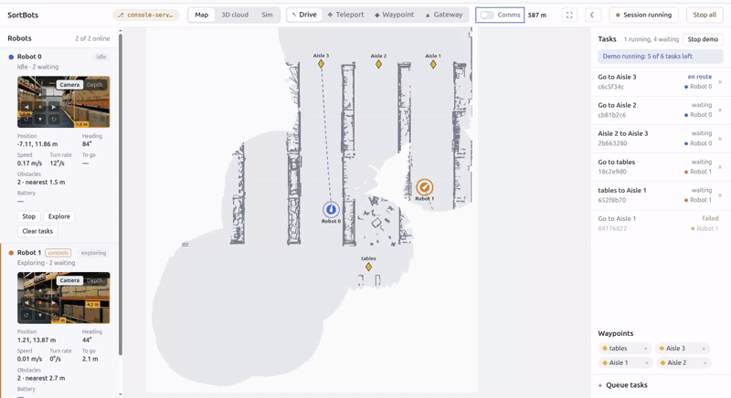
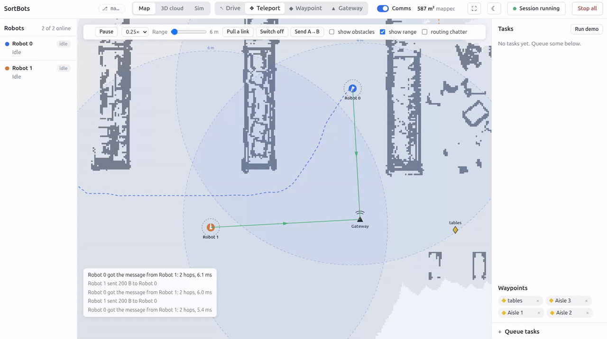
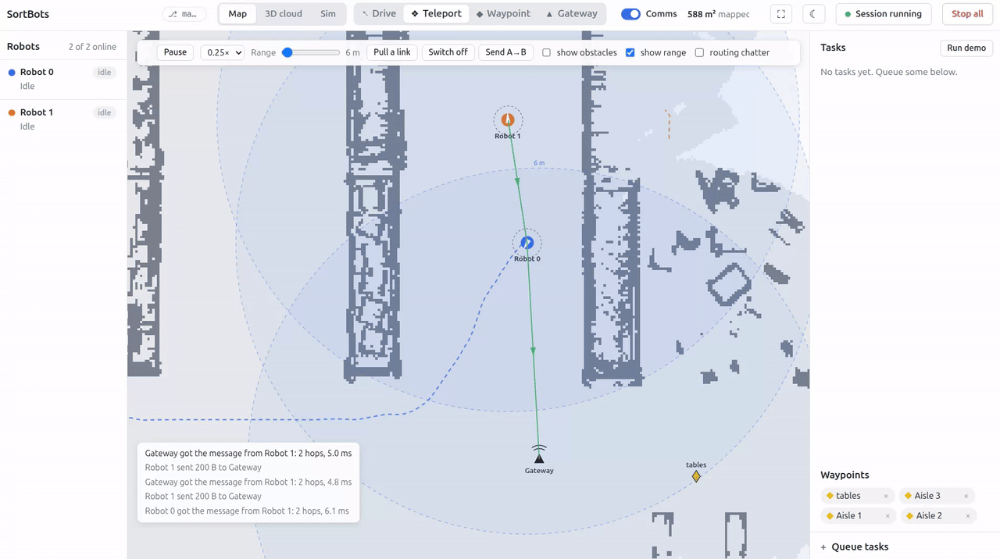
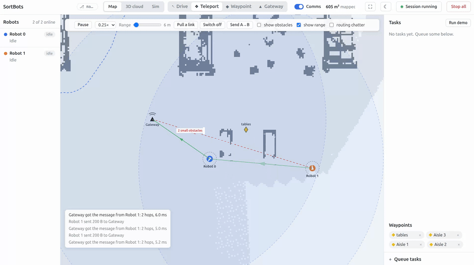

# SortBots

Fully autonomous mobile robots performing collaborative
indoor logistics, built on
[XLeRobot](https://github.com/Vector-Wangel/XLeRobot).

Unlike commercial AMR
systems that rely on extensive per-facility infrastructure,
SortBots targets the opposite operating point: rapid deployment
in unmapped environments, with collaboration as the primary
mechanism for both efficiency and resilience. Robots divide work via decentralized task allocation,
coordinate passage through shared spaces, and dynamically
re-allocate tasks when one is blocked or delayed. Applications to autonomous delivery logistics in dynamic enviornemnts, such as warehouses, shelf restocking, or serving foods in restaurants.

## Warehouse Logistics

Using a magnetic end effector, the robot picks up a package from a pick location, loads it into its storage basket, then brings it to the dropoff location.

## Operator dashboard

A warehouse operator can manage multiple robots and assign tasks for avaliable robots to pick up. 

## SLAM mapping (RTAB-Map)

Robots are able to operate in an enviornment with no prior knowledge of what the enviornment looks like, by mapping it in real time. 

## Obstacle detection

Robots use a combination of vision and depth based algorithms in order to identify and avoid dynamic obstacles

| Pedestrian | Another robot |
|---|---|
|  |  |

## Fleet mesh comms

| Both in range | 2-hop relay | Direct vs. routed |
|---|---|---|
|  |  |  |

## Docs

[Setup](docs/setup.md) · [Running](docs/running.md) · [Architecture](docs/architecture.md) ·
[Testing](docs/testing.md) · [Real robot](docs/real-robot.md) · [Mapping movers](docs/mapping-movers.md) ·
[Manipulation](docs/manipulation.md) · [Arm](docs/arm.md) · [Head camera](docs/head_camera.md) ·
[Magnet](docs/magnet.md) · [Drive](docs/drive.md) · [Comms](docs/commsim.md)

## License

Project code: license to be added. The XLeRobot submodule is Apache 2.0
(`third_party/XLeRobot/LICENSE`).
