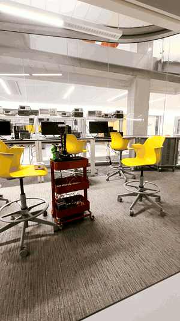
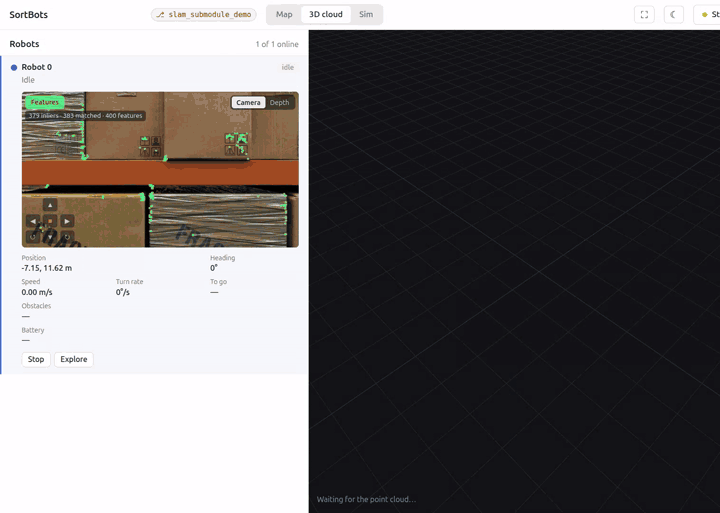
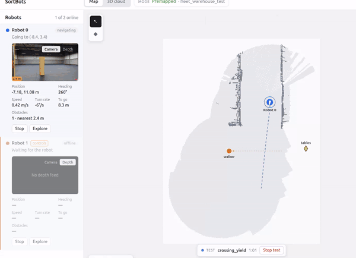
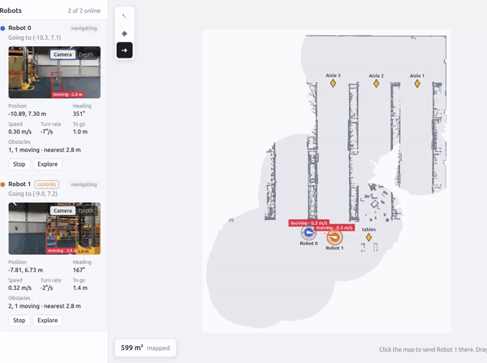

# SortBots

Autonomous mobile robots for collaborative indoor logistics, built on
[XLeRobot](https://github.com/Vector-Wangel/XLeRobot): rapid deployment in
unmapped spaces, with decentralized task allocation between robots.

## Pick and place

The real robot picks a package out of its own basket and places it on the chair beside it (sped up).

## Operator dashboard

## SLAM mapping (RTAB-Map)

## Obstacle detection

| Pedestrian | Another robot |
|---|---|
|  |  |

## Fleet mesh comms

| Both in range | 2-hop relay | Direct vs. routed |
|---|---|---|
|  |  |  |

## Docs

[Setup](docs/setup.md) · [Running](docs/running.md) · [Architecture](docs/architecture.md) ·
[Testing](docs/testing.md) · [Real robot](docs/real-robot.md) · [Manipulation](docs/manipulation.md) ·
[Arm](docs/arm.md) · [Head camera](docs/head_camera.md) · [Magnet](docs/magnet.md) ·
[Drive](docs/drive.md) · [Comms](docs/commsim.md)

## License

Project code: license to be added. The XLeRobot submodule is Apache 2.0
(`third_party/XLeRobot/LICENSE`).
