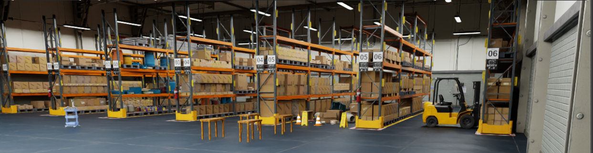
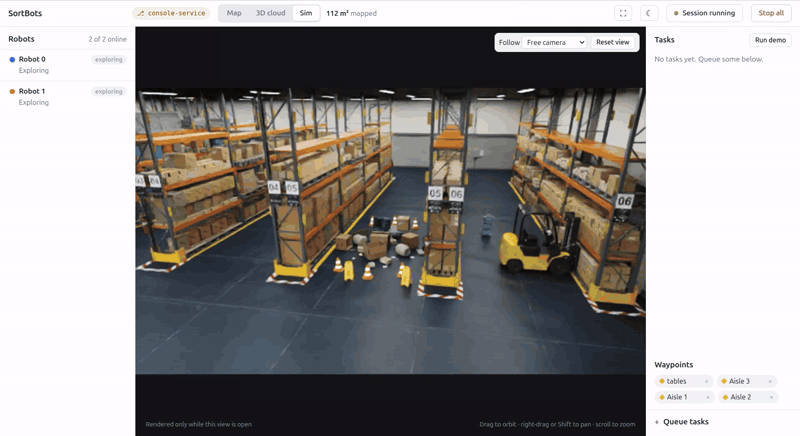
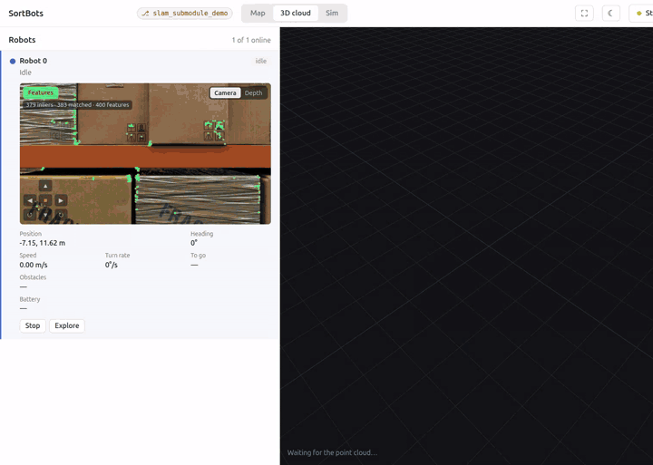
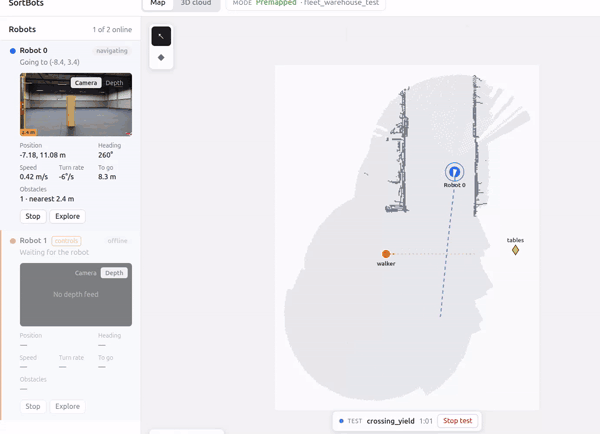
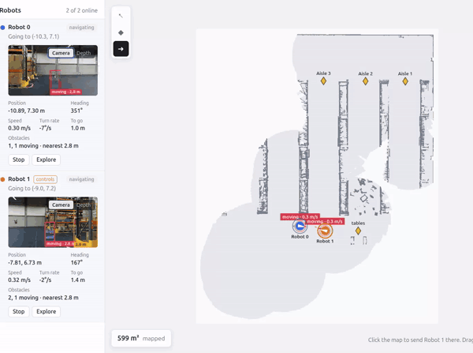
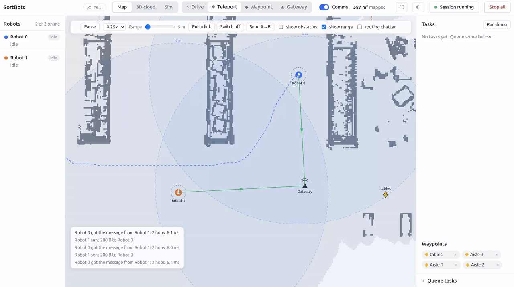
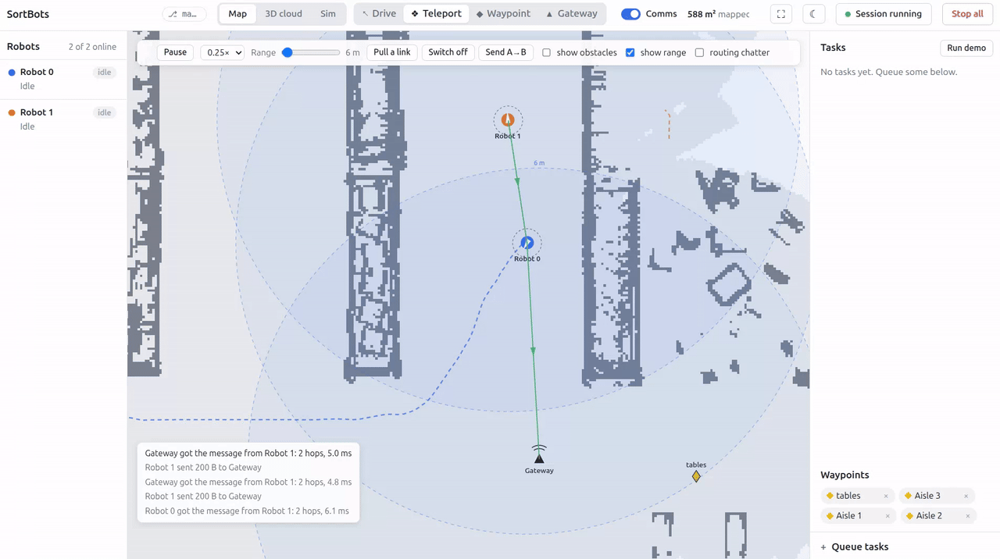
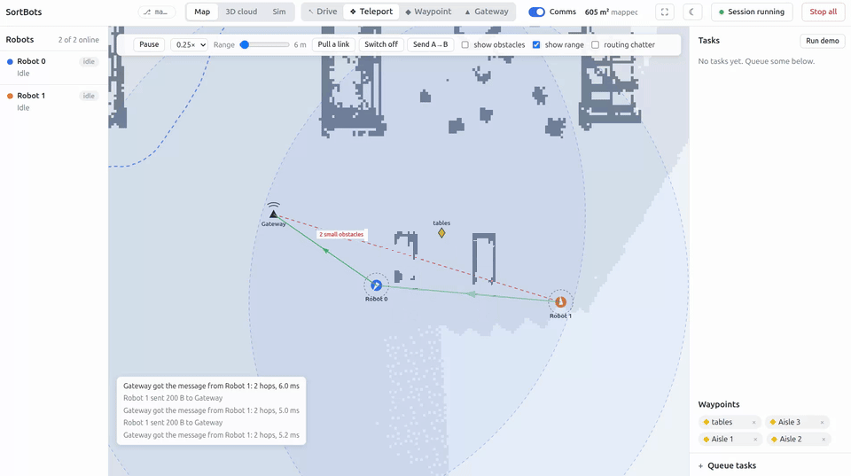
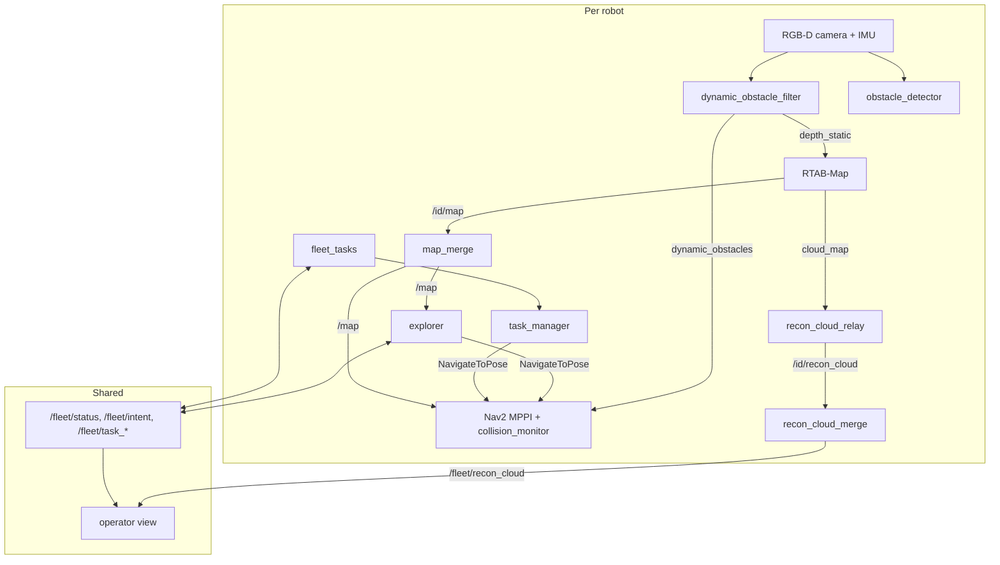

# SortBots




Fully autonomous mobile robots performing collaborative
indoor logistics, built on
[XLeRobot](https://github.com/Vector-Wangel/XLeRobot).

Unlike commercial AMR
systems that rely on extensive per-facility infrastructure,
SortBots targets the opposite operating point: rapid deployment
in unmapped environments, with collaboration as the primary
mechanism for both efficiency and resilience. Robots divide work via decentralized task allocation,
coordinate passage through shared spaces, and dynamically
re-allocate tasks when one is blocked or delayed. Applications to autonomous delivery logistics in dynamic enviornemnts, such as warehouses, shelf restocking, or serving foods in restaurants.

### Operator dashboard

Driving, teleport, waypoints and live camera/depth feeds for both robots from one browser tab:



### SLAM Mapping and 3D Reconstruction (RTAB-Map) 



### Object detection validation

Scripted test cases from the [simtest](simtest/) layer: detecting a crossing pedestrian, and one robot detecting another.

| Detect pedestrian | Detect other robot |
|---|---|
|  |  |

### Fleet mesh comms overlay

The Comms overlay modeling Wi-Fi mesh range and link quality between robots and the gateway: both robots in direct range of the gateway, a robot out of range relaying through the other, and the overlay comparing a direct line-of-sight link against the routed path when obstacles are in the way.

| Both robots in range | 2-hop relay | Direct vs. routed |
|---|---|---|
|  |  |  |

### Simulation infrastructure
- **Isaac Sim** Isaac Sim 5.1 supporting SLAM pipelines and integrating with Nvidia packages such as RTAB-Map

## Documentation

This README is the project's documentation. Agent-specific notes are in `CLAUDE.md`
and the `sim-run` skill (`.claude/skills/sim-run/`). Some code comments cite older
design notes and run logs as `path@6501799`. Those files were folded into this README,
and the originals can be read with `git show 6501799:path`.

### Contents

1. [Overview](#1-overview)
2. [Setup](#2-setup)
3. [Running the sim](#3-running-the-sim)
4. [The operator view](#4-the-operator-view)
5. [Architecture](#5-architecture)
6. [Maps](#6-maps)
7. [The real robot (Jetson)](#7-the-real-robot-jetson)
8. [Gaussian splats](#8-gaussian-splats)
9. [Testing](#9-testing)
10. [Fleet comms (`commsim/`)](#10-fleet-comms-commsim)
11. [ManiSkill arm track](#11-maniskill-arm-track)
12. [Hardware: magnet end effector](#12-hardware-magnet-end-effector)
13. [Pick and place (sim)](#13-pick-and-place-sim)
14. [Troubleshooting](#14-troubleshooting)

---

## 1. Overview

There are three tracks. They share no shell.

| Track | What | Environment |
|---|---|---|
| **Isaac Sim + ROS 2 Jazzy** (main) | mobility, SLAM, Nav2, fleet | `~/isaacsim/venv` plus system ROS 2, each in its own subshell |
| **Real robot** | the same stack on a Jetson Orin Nano with a RealSense D435 | Jazzy Docker container (`docker/jetson/`) |
| **ManiSkill** | arm manipulation | conda env `lerobot` |

This is **not a colcon workspace**. There is no `src/` and no `package.xml`. Nodes
are loose scripts started by path. Inter-node messages are `std_msgs/String`
carrying JSON. Node tuning is plain YAML that each node loads itself.

| Path | Contents |
|---|---|
| `nodes/` | rclpy nodes (`explorer.py`, `task_manager.py`, `map_merge.py`, …), run as `python3 <path> --robot-id …` |
| `launch/` | `ros2 launch ./launch/<file>`, by path. `sortbots_bringup.launch.py` is the entry point |
| `scripts/` | entry points: `run_console.sh`, `sim_ctl.sh`, `run_demo.sh`, `run_robot.sh`, `jetson.sh`, `maps.sh`, `simtest.py`, `splat.sh`, installers |
| `webui/` | the operator view (vanilla JS, no build step), `serve.py` (HTTP + control API), `session.py` (scenario runner) |
| `configs/` | tuning YAML, `scenarios/`, `worlds/`, `tests/`, `robots.yaml` (roster and spawn poses) |
| `simtest/` | scored live tests: worlds, probe, versioned metrics |
| `maps/` | committed library of saved maps (git-lfs) |
| `splat/` | Gaussian-splat reconstruction (workstation only) |
| `commsim/` | fleet radio and task-protocol simulation |
| `hardware/` | CAD for the SO-101 electromagnet end effector |
| `third_party/XLeRobot` | submodule (Apache 2.0) |

**Invariants that cost the most time when broken:**

- **Never `source /opt/ros/...` in a shell that launches the sim**, and never in
  `~/.bashrc`. It shadows the Isaac venv and conda. The scripts source ROS in their
  own subshells and refuse to run if `AMENT_PREFIX_PATH` is set.
- **conda's `python3` leads PATH.** Anything with an `#!/usr/bin/env python3` shebang
  that needs rclpy (rosbridge, `ros2`) fails with `No module named
  'rclpy._rclpy_pybind11'`. In ROS shells, `which python3` must print `/usr/bin/python3`.
- **Every web_video_server `/snapshot` request needs `qos_profile=sensor_data`**,
  ad-hoc `curl` included. Churning RELIABLE image subscriptions kill Isaac's image
  writers at around sim t=100–140 s.
- **A saved map is loaded by copy, never in place** (see [Maps](#6-maps)).
- **Measure speed in sim time.** The real-time factor depends on how many cameras
  render: about 0.47× with 2 robots, 0.33× with a chase cam added, 0.25× with the
  full ROS stack. `scripts/bench_sim.sh` measures it.

---

## 2. Setup

**Requirements:** Ubuntu 22.04 or 24.04 on an **X11** session (Kit and SAPIEN
misbehave on Wayland). An NVIDIA RTX GPU with ≥ 8 GB VRAM and driver R535–R580.
About 30 GB free (50 GB with ManiSkill). Python 3.11 for the Isaac venv.

```bash
# 1. system packages
sudo apt-get install -y libvulkan1 vulkan-tools libglvnd-dev mesa-utils libegl1 libgl1 \
    libxext6 libx11-6 libxcb-cursor0 libxkbcommon-x11-0 libglu1-mesa \
    build-essential git curl ca-certificates git-lfs
git lfs install
vulkaninfo --summary | grep -i nvidia        # must list your GPU, not just llvmpipe

# 2. clone (git-lfs pulls the saved maps; without it they are 130-byte pointer files)
git clone --recurse-submodules <repo-url> sortbots_ws && cd sortbots_ws
git lfs pull

# 3. Isaac Sim 5.1, in a clean shell (no conda, no ROS)
bash scripts/install_isaac_sim.sh                     # preflight only
bash scripts/install_isaac_sim.sh --accept-download   # ~15 min, idempotent → ~/isaacsim/venv
source scripts/activate_isaac.sh && python scripts/verify_isaac_sim.py   # "OK"; close the shell after

# 4. ROS 2 Jazzy (add the apt repo per docs.ros.org first)
sudo apt install -y ros-jazzy-desktop ros-jazzy-rtabmap-ros ros-jazzy-navigation2 \
    ros-jazzy-nav2-bringup ros-jazzy-rosbridge-suite ros-jazzy-web-video-server \
    ros-jazzy-depth-image-proc
```

The first run auto-builds the robot USD (`scripts/import_urdf.py`) and streams the
NVIDIA warehouse assets, which takes a few minutes. Both are cached after that.

---

## 3. Running the sim

### Console mode (day to day)

From a clean shell:

```bash
scripts/run_console.sh          # rosbridge :9090, web_video_server :8080, serve.py :8081. Leave it running.
```

Open <http://localhost:8081/>, click **Session**, pick a scenario and press
**Start**. The panel streams the launcher's log and its phase (`starting Isaac Sim →
loading the warehouse → sim publishing → starting RTAB-Map + Nav2 → running`).
**Save & finish** saves the map into `maps/` and stops the run. **Stop** stops
without saving. Either way the console stays up. `scripts/run_console.sh stop` takes
down the console and any running sim.

Each run logs to `data/sessions/<timestamp>_<scenario>/`. A restarted console
re-adopts a sim that is still running.

### Scripted (`sim_ctl.sh`, for automation and agents)

Exit codes are the interface: `0` ok, `1` failure, `3` no console, `4` nothing
running, `124` timeout.

```bash
scripts/sim_ctl.sh console start                  # detached
scripts/sim_ctl.sh list                           # scenarios
scripts/sim_ctl.sh dry-run explore_fleet          # print the command, launch nothing
scripts/sim_ctl.sh start explore_fleet headless=true
scripts/sim_ctl.sh start custom map=warehouse mode=extend robots=2   # the launch form, as k=v
scripts/sim_ctl.sh wait running --timeout 420     # first run streams assets
scripts/sim_ctl.sh status
scripts/sim_ctl.sh log --lines 100
scripts/sim_ctl.sh stop [--save-map NAME [--splat]]
```

### CLI only (`run_demo.sh`)

```bash
scripts/run_demo.sh                 # 2-robot fleet + dashboard
scripts/run_demo.sh --explore       # ...exploring autonomously
scripts/run_demo.sh --robots 1      # single robot
scripts/run_demo.sh --teleop        # add a WASD terminal window
scripts/run_demo.sh stop
```

`run_demo.sh` returns as soon as everything has launched. Check liveness with
`pgrep -f spawn_warehouse.py`, not its exit code.

### Scenarios (`configs/scenarios/`)

| Scenario | What it does |
|---|---|
| `explore_fleet` | **default**: 2 robots explore from empty maps, fused into one `/map` |
| `explore_fresh` / `explore_resume` | 1 robot, fresh map / extend the working map |
| `library_localize` / `library_resume` | a saved map from `maps/`, read-only / keep mapping |
| `fleet_demo` | premapped warehouse, 2 robots, for the task demo |
| `fleet_scale` | 4+ robots waiting for goals (`robots=` overridable) |
| `moving_obstacles`, `_mapped`, `_fleet` | worlds with scripted walkers, for watching live and for tests |
| `pick_bench` | fresh map, no Nav2 goals: the base for pick and place tests ([§13](#13-pick-and-place-sim)) |
| `real_map_fresh`, `real_localize`, `real_map_offload` | the Jetson (`platform: real`) |

A scenario is one YAML file whose filename matches `name`. `run:` accepts only
allowlisted keys (`RUN_FLAGS` in `webui/session.py`). Unknown keys make the scenario
`invalid` rather than being passed through.

```yaml
name: explore_fresh
title: Frontier exploration — fresh map
description: Shown in the launch form.
status: ready                 # ready | planned
run:
  scene: nvidia               # nvidia | primitive
  robots: 1
  headless: true
  chase_cam: true
  explore: true
  resume: false               # resume / localize are mutually exclusive
  localize: false
  map: null                   # null → ~/.ros/sortbots_<robot_id>.db
overrides: [headless, robots] # keys the launch form may change
capture: {bag: false}
```

Check scenarios offline with `python3 webui/session.py --list` or `--print-argv NAME
[--set k=v]`. **Save as preset…** in the launch form writes a new one.

### Performance knobs

- **Render products dominate cost** (about 85%). Chase cams are off for fleet runs by
  default. `half_res_cams` renders head cameras at 424×240.
- On a GPU-bound laptop, `render_every=2` + `lite_render=true` took `explore_fleet`
  from 0.38× to 0.81×. A CPU-bound desktop only speeds up with fewer render products.
- **Memory:** Isaac plus the console take about 6.8 GB. Each robot adds about
  1.5 GB, plus RTAB-Map growth of about 3.5 MB per sim-second while mapping.
  Past 4 robots the limit is CPU at startup, not RAM. `run_demo.sh` runs the
  pipeline in a systemd memory fence, and `scripts/mem_guard.py` stops the run
  cleanly before the OOM killer acts (`SORTBOTS_NO_MEM_GUARD=1` disables it).
  `scripts/mem_probe.py record|summarize` breaks usage down per robot.

### Always-on console and remote access

```bash
scripts/console_service.sh install    # systemd user service serving this checkout
scripts/console_service.sh deploy     # serve a worktree of main (~/SortBots-prod), auto-updated every 5 min
python3 scripts/webui_url.py          # print the tailnet URL
```

Every port binds `0.0.0.0`, so any device on the Tailscale tailnet can reach the
operator view at `http://<host>.ts.net:8081/`. Use plain http there: the page
derives its rosbridge and video hosts from its own origin. For a public URL, Tailscale
Funnel can expose 8081→443, 9090→8443 and 8080→10000. **The control API is not
authenticated, and rosbridge can publish to any topic.** Tailnet ACLs are the only
perimeter, so treat a Funnel URL as a secret.

### The ROS side without the launcher

With Isaac already running (`scripts/spawn_warehouse.py`), in a ROS-sourced shell:

```bash
ros2 launch ./launch/sortbots_bringup.launch.py robot_ids:=robot_0,robot_1 \
    [nav2:=false] [webui:=false] [task_manager:=false] [rviz:=true]
```

---

## 4. The operator view

`webui/operator.html` is the **only** GUI. New UI belongs inside it as a view,
panel or popover. Never add a second page or port.

- **Header:** pick the stage (**Map** / **3D cloud** / **Sim**), the **Comms**
  overlay, **Session** (the launch form), **Stop all** (cancels every goal and
  zeroes `cmd_vel`), and the alarm chip.
- **Robot cards (left):** camera/depth tile, current task, pose, speed and the
  distance left on the plan. The card used most recently has control: map clicks
  and waypoint chips go to that robot.
- **Stage (centre):**
  - 2D: the fused `/map` with robot poses, Nav2 plans, waypoints and select /
    waypoint / send-robot tools (drag to set heading).
  - 3D: `/fleet/recon_cloud`, throttled to one cloud per 8 s.
  - **Sim:** Isaac's own floor camera. It renders only while a page sends
    heartbeats; drag to orbit, **Follow** to ride along.
- **Tasks (right):** per-robot FIFO queues from `task_manager`. **Moves** queues
  ordered `goto`s. **Pick & drop** queues pickup→dropoff. **Any robot** sends the
  task to the fleet auction. **Run demo** runs `configs/demo_tasks.yaml` in phases.
- **Exploring:** each robot card has an **Explore** / **Stop exploring** button.
  **Save & finish** in Session saves the run into `maps/` and then stops it.
- **Comms overlay:** commsim's radio model running live on the real poses and map:
  predicted links, mesh routes and message hops. What-ifs (pull a link, switch off
  a robot, range slider) change only the model, never the real fleet. Drop the
  gateway pin with ▲.

Test it offline. There is no sim, no ROS and no npm install; it uses a fake
ROSLIB in headless Chrome:

```bash
node webui/tests/operator_test.mjs [--screenshot DIR]
scripts/replay_dashboard_bag.sh <bag-dir>     # eyeball a recorded bag with real rosbridge
```

Never point a browser at a live sim to test the UI. Record a bag and replay it.

---

## 5. Architecture



**Fusion, not collaborative SLAM.** Each robot runs its own RTAB-Map in its own
`<id>/map` frame. The bringup publishes a static `map → <id>/map` transform from each
robot's spawn pose (`configs/robots.yaml`). `map_merge.py` and `recon_cloud_merge.py`
resample every robot's grid and cloud into the world `map` frame. Where grids
disagree, occupied beats free beats unknown. There is no shared pose graph and no
inter-robot loop closure. Robots never read each other's poses off `/tf`. Peers are
known only from self-reported `/fleet/status`, the same radio channel a real fleet
would have.

### Perception

| Node | Job |
|---|---|
| `dynamic_obstacle_filter.py` | Masks moving pixels, plus pixels within 0.5 m of a peer's reported pose, out of depth → `depth_static` (keeps movers out of SLAM) and `dynamic_obstacles` (to Nav2). Sim only. |
| `obstacle_detector.py` | Geometric clusters above the floor, tracked in odom with a `moving` flag → `/<id>/obstacle_tracks` (JSON), `obstacle_points`, `obstacles_viz`. No classifier: geometry catches anything with physical extent, at about 13 ms/frame. Runs on both platforms. Tuning: `configs/obstacle_detector.yaml`. |
| `obstacle_cloud.py` | The real robot's raw live obstacle cloud when SLAM is offloaded. |
| RTAB-Map | One per robot (`launch/sortbots_rtabmap_robot.launch.py`). Started with `MALLOC_ARENA_MAX=2`, which cut its memory growth by about half. |
| `recon_cloud_relay.py` | Caps `cloud_map` at 200k points so rosbridge and the browser can keep up. |

Sim topics live under `/<id>/`: `camera/{rgb,depth,camera_info}`, `imu`, `odom`,
`cmd_vel`. TF frames are prefixed (`robot_0/base_link`) on the shared `/tf`.

### Navigation and exploration

- **Nav2** (`configs/nav2_params.yaml`, rewritten per robot by
  `sortbots_nav2.launch.py`): MPPI with a `DiffDrive` motion model so the forward
  camera faces the direction of travel, a reactive BT, and `collision_monitor` as
  the last-resort stop. The base is holonomic, but Nav2 never commands strafing.
- **Two namespacing traps:** the costmap's `map_topic` must be absolute, and
  `behavior_server` needs `local_frame: robot_0/odom` set explicitly. With that
  unset, every recovery aborts instantly and a wedged robot can never free itself.
  In params YAML under a namespace, key nodes as `/**/<node>:`.
- **Explorer** (`nodes/explorer.py`, `configs/explorer.yaml`): frontier exploration
  on the fused `/map`. It scores frontiers by size, distance and openness, and
  blacklists unreachable ones with escalating strikes. It retargets as soon as the
  frontier it was heading to gets revealed en route. It also has an escape /
  backtrack / stuck watchdog and a startup spin. Fleet deconfliction uses
  `/fleet/intent` (goal and corridor; lower priority yields) and `/fleet/status`.
- **Steering:** `<id>/explore_hint` `{"x","y"[,"append"]}` locks the explorer onto
  the frontier nearest the click until that area is mapped, `steer_ttl_s` expires,
  or the frontier proves unreachable.
- **Timers:** `create_timer` follows `use_sim_time`, which stretches a control tick
  by the real-time factor. Put deadlines on sim time and responsiveness ticks on an
  explicit steady clock, as `explorer.py` does.

### Tasks and the fleet auction

`task_manager.py` keeps one FIFO queue per robot and drives Nav2 through pickup →
dropoff. `fleet_tasks.py` runs on every robot, plus one `--gateway` instance in the
sim bringup. There is no central dispatcher. Every robot runs the same allocator
(`commsim/core/protocol.py`) on the same messages, so they all agree on the winner:

- The gateway announces each task from `/fleet/task_request`.
- Robots bid seconds of driving on the fused map (`grid_dist.py`), plus their
  backlog and a battery penalty. A robot under 20% battery stops bidding.
- The cheapest robot claims the task after a 1 s window. A robot holds up to 3 tasks.
- Leases (1 Hz beacon, 10 s expiry) move a task off a robot that went silent.
- Once a load is on board, the task never moves. The others raise `owner_missing`
  instead.
- A majority quorum stops a network split from putting two robots on one task.

The gateway publishes `/fleet/task_board` (latched, 1 Hz) and latches alarms
(`robot_silent`, `owner_missing`, `lease_expired`, `task_stalled`) until they are
acknowledged on `/fleet/alarm_ack`. Tuning is in `configs/fleet_tasks.yaml`.

```bash
ros2 topic pub --once /fleet/task_request std_msgs/String '{data: "{\"pickup\": \"A\", \"dropoff\": \"B\"}"}'
```

---

## 6. Maps

| Mode | Flags | Pose graph |
|---|---|---|
| fresh | *(default)* | wiped and rebuilt |
| resume | `--resume` | reopened and extended |
| localize | `--localize` | reopened read-only (`Mem/IncrementalMemory=false`) |
| library | `--map maps/<name>/map.db` + `--resume`/`--localize` | **copied** to `~/.ros/sortbots_<id>.db`, and the copy is used |

The working database is `~/.ros/sortbots_<robot_id>.db`, one per robot. RTAB-Map
opens its sqlite file read-write even under `--localize`, which is why library maps
are always copied. Otherwise every demo would dirty a tracked git-lfs object.

**The library** (`maps/<name>/`: `map.json` manifest, `grid.pgm`/`grid.yaml`,
`map.db`, plus `map_<rid>.db` per extra robot):

```bash
scripts/maps.sh list | show NAME | verify NAME | rm NAME
scripts/sim_ctl.sh stop --save-map NAME            # save + stop in one step
scripts/sim_ctl.sh start library_localize map=$PWD/maps/NAME/map.db
```

Saving has two halves. The grid has to come off the live `/map` while the stack is
**up**. A safe copy of the database needs the stack **down**, or RTAB-Map's own
backup service. So `maps.sh save` is idempotent: a mid-run save can land as
`db_state: pending`, and a second save after teardown completes it (exit 5 means
pending). Names match `^[a-z0-9][a-z0-9_-]{0,63}$`. Entries are 100+ MB, so prefer
a new name over re-saving an old one.

**Several robots on one saved map:** every robot gets a copy and an initial pose
relative to robot_0. Each switches from localizing to mapping only after a real
visual match. Only robot_0's database is saved back.

Other tools: `scripts/save_map.sh` (per-run checkpoints under `data/runs/`) and
`scripts/map_coverage.py [--live]` (how much of the warehouse is mapped).

---

## 7. The real robot (Jetson)

JetPack 6 is Ubuntu 22.04 (Humble), but this repo is Jazzy, so the stack runs in a
Jazzy container (`docker/jetson/`). **Never source the host's `/opt/ros/humble`,**
and never run its RealSense node: only one process can own the D435.

```
phone ──:8081/:9090/:8080──▶ Jetson ─ docker sortbots-jetson:jazzy
                                 ├─ run_console.sh --platform real
                                 └─ run_robot.sh → sortbots_bringup.launch.py platform:=real
                                      realsense2_camera → /robot_0/camera/*, RTAB-Map visual odometry
```

**Host setup (once):**

1. Add yourself to the docker group, and check `docker info | grep nvidia`.
2. Install the RealSense udev rules (`99-realsense-libusb.rules`).
3. Plug the D435 into a USB **3** port. `lsusb -t` must show `5000M`; at 480M the
   driver falls back to 640×480@15.
4. Set the power mode: `sudo nvpmodel -m 2 && sudo jetson_clocks`.

```bash
scripts/jetson.sh build      # first time, 10–20 min
scripts/jetson.sh console    # dashboard console in container 'sortbots'
scripts/jetson.sh status | shell | logs | stop
```

Open `http://jetson-orin.<tailnet>.ts.net:8081/` and start `real_map_fresh`. Move
the robot slowly: fast turns and blank walls lose visual odometry.

**Differences from the sim:**

- `use_sim_time:=false`.
- Visual odometry on raw depth instead of Isaac's perfect odometry.
- No IMU (`wait_imu_to_init:=false`).
- Depth is 16UC1 mm.
- The map anchor is `spawn.real`.
- Nav2, the explorer and task_manager are **off** until a base driver exists.
- DDS is localhost-only, so a desktop sim on the LAN can't cross-talk with
  `/robot_0/*`.
- `SORTBOTS_PLATFORM=real` must be set inside the container. `jetson.sh` sets it.

The camera mount in `configs/sensors/d435_real.yaml` is still a placeholder. Measure
it. A 1.2 MB D435 frame doesn't fit Fast DDS's default 512 KB shared-memory segment,
and silently dropped UDP fragments starved odometry. `configs/dds/fastdds_large_shm.xml`
(set by `jetson.sh`) fixes that.

**Viewing on the Jetson's own screen:** snap browsers need `SNAP_REEXEC=0`. For WebGL
without a GPU, add `--disable-gpu --enable-unsafe-swiftshader --ignore-gpu-blocklist`.
Viewing from another device is better.

### SLAM offload

On the Orin Nano, mapping competes with odometry and obstacle detection. With
`slam_role` set to `robot`, the Jetson keeps the camera driver, odometry, the live
obstacle cloud and 2 Hz compressed keyframes. The workstation runs RTAB-Map. On a
bench at 2× speed, this cut SLAM trajectory error from 2.8–4.7 m to about 0.5 m and
obstacle latency p50 from about 80 ms to about 35 ms, using about 1 Mb/s of link.

```bash
# workstation
export ROS_AUTOMATIC_DISCOVERY_RANGE=LOCALHOST ROS_STATIC_PEERS=<jetson>
ros2 launch ./launch/sortbots_slam_workstation.launch.py robot_id:=robot_0
# jetson
SORTBOTS_WORKSTATION=<workstation> scripts/jetson.sh console   # then scenario real_map_offload
```

Without a workstation, the default `--slam-role all` maps on the Jetson at `nice 10`.
`docker/slam_bench/` and `scripts/slam_bench/` reproduce the bench.

**Next hardware steps:**

- A base driver (`cmd_vel` → motors, `odom`), after which Nav2, the explorer and
  task_manager can be enabled on the robot.
- An MPU6050 driver feeding `imu_filter_madgwick`.
- cuVSLAM, which needs JetPack 7.2.
- Mesh radios (see [§10](#10-fleet-comms-commsim)).

---

## 8. Gaussian splats

The 3D panel's **splat** mode shows a photoreal Gaussian splat of a saved map. It
is trained after the run, **on the workstation GPU only, never the Jetson**, in its
own conda env `splat`. The pipeline: `rtabmap-export` dumps keyframes and poses,
gsplat trains, and the result is anchored into the fleet `map` frame.

```bash
scripts/install_splat.sh [--check]     # once (pinned torch 2.4 / gsplat 1.5.3 prebuilt wheels)
scripts/splat.sh serve                 # worker on :8082
scripts/sim_ctl.sh stop --save-map NAME --splat                     # sim
scripts/splat.sh build NAME --from http://jetson-orin.<tailnet>:8081 --wait   # real robot's map
scripts/splat.sh status | log JOB
```

A 1,157-keyframe map takes about 4 min and produces about 42 MB. Jobs wait while
Isaac holds the GPU. Output goes to `~/.cache/sortbots/splats/`. On the robot, set
`worker_url` in `configs/splat.yaml` to the workstation.

---

## 9. Testing

### Offline (seconds; no GPU, ROS or display). This is what CI runs.

```bash
make ci                                   # pytest + scenario smoke, system python3
/usr/bin/python3 -m pytest tests/         # node logic (NOT conda's python: no pytest there)
node webui/tests/operator_test.mjs        # operator view
python3 webui/session.py --list           # scenario validation
scripts/simtest.py validate               # scored test cases resolve
/usr/bin/python3 -m pytest commsim/tests
```

### Scored live tests (`simtest/`)

There are three layers, kept separate on purpose:

| Layer | File | Answers |
|---|---|---|
| world | `configs/worlds/NAME.yaml` | what's on the floor: static props, scripted walkers (fixed paths, never react, not colliders), and packages the magnet can pick |
| scenario | `configs/scenarios/NAME.yaml` | how the stack runs |
| test case | `configs/tests/NAME.yaml` | goals/tasks, stop condition, metrics + pass criteria, repeats, variants |

```bash
scripts/simtest.py list | show NAME | metrics
scripts/simtest.py run crossing_yield [--repeats 3] [--set overrides.world=aisle_head_on]
scripts/simtest.py rescore data/simtests/<dir>     # re-score recorded events, no sim
scripts/simtest.py report DIR_A DIR_B
```

Test cases: `pipeline_smoke` (the cheapest harness check), `crossing_yield`,
`head_on_pass`, `cluttered_route`, `fleet_traffic`, `fleet_scale_smoke`, and the pick and
place tests in [§13](#13-pick-and-place-sim). A test's `section:` is its heading on the
operator view's Tests tab. `parked: true` keeps a test off the tab, but `simtest.py` can
still run it. The operator test serves on port 8201. If another session's console is
already using that port, pass `--port N --cdp-port M`.

**Other world keys:**

- `packages:`: up to 16 boxes, each with `size`, `pose` [x, y, yaw], `z` (the height of
  its bottom: 0 for the floor, or exactly a prop's top), `magnet_face` (`+x -x +y -y top`)
  and `color`. A package that floats or sits inside a prop is rejected at load. Packages
  are visual only, and the magnet snaps them.
- `marker: N` (0–9): an ArUco id (DICT_4X4_50) on a package's plate. A task on that
  package then needs no location.
- `style: table`: makes a box prop look like a table. It still collides as a solid box.
- `marks:`: painted target rectangles.
- `head: {pan, tilt}`: the head's starting angle.
- `view: {eye, target}`: aims the Sim view's camera.

In a world with packages, ground truth also carries `packages` (pose, `held_by`),
`magnet` (energized, held, tcp, nearest plate) and `head`.

How a run works:

1. A probe waits for the stack to be ready, then restarts the **world clock**, so
   walkers and goals share t=0.
2. Goals are sent on schedule.
3. Topics are recorded as events to `events.jsonl.gz`.
4. The run is scored when it stops.

Ground truth is on `/sim/ground_truth` (10 Hz JSON). The world layout is
`/sim/world`, and `/sim/world_cmd` restarts or pauses it. World coordinates are the
map frame.

- **Metrics** (`simtest/metrics/`): `clearance`, `goals`, `map_contamination`,
  `detection`, `coverage`, `tasks`, `pick_place`, `run_stats`. They are pure functions of recorded
  events. To change one, edit it, bump its `version`, then `rescore`.
- **Verdicts:** a criterion with no data FAILS.
- **Exit codes:** 0 pass, 1 fail, 2 invalid, 3 no score.
- **Results:** `data/simtests/<UTC>_<name>/`.

Avoidance tests run on a saved map (`moving_obstacles_mapped`): Nav2 rejects goals
outside the known map. On a shared network, set a private `ROS_DOMAIN_ID` and
restart the console. A teammate's stack on domain 0 is the same `/robot_0` graph.

---

## 10. Fleet comms (`commsim/`)

The fleet has no central coordinator, so ownership and liveness are decided over the
radio. commsim tested that design to failure before any radios were bought. The
design is a self-healing Wi-Fi mesh (802.11s + batman-adv), Zenoh, and the auction +
lease protocol. As first written, it failed at every fleet size. After four fixes it
supports about 20 robots in simulation and passes 110 of 120 failure scenarios, and
the same `core/protocol.py` runs on the robots.

| Fix (now the default) | Problem it solved |
|---|---|
| leases renewed by a fleet-wide beacon | robots reclaimed tasks still being carried |
| only the lower robot ID dials | two TCP sessions per pair wasted a third to a half of the airtime |
| status timeout 6 s, Zenoh lease 4 s | one broken link made healthy robots look silent |
| Status subscriber queue depth 32 | 15% of Status messages lost on a clean link |

There are two cross-checked tools. Median latency agrees within 3–10%.

- **`emu/`** runs the real stack in network namespaces over `mac80211_hwsim`, inside
  an Ubuntu 24.04 VM (`commsim/vm/provision_vm.sh`, created with Multipass).
- **`des/`** is a discrete-event model, used for scale and failure sweeps on the host.

All radio numbers are **placeholders** until real hardware is measured. Run
everything with `/usr/bin/python3` from the repo root.

```bash
/usr/bin/python3 -m commsim.des.run --variants V3 V4 --n 10 15 20 --seeds 1 2 3 --until-fail --out commsim/results/mine
/usr/bin/python3 -m commsim.des.scenarios --variants V4 --n 10 --seeds 1 --out commsim/results/scen
/usr/bin/python3 -m commsim.des.crosscheck [n10]          # model vs emulation (commsim/measurements/)
commsim/scripts/fix_sweep.sh                               # full before/after comparison (~1 h)
sudo python3 -m commsim.emu.mesh up --n 3 --line           # in the VM
```

Configs: `configs/base.yaml` (the recommended design), `hw_lab.yaml` (2 robots +
gateway), `spec_original.yaml` (as first written).

**Real routers** (OpenWrt, one per robot):

1. Build images with the mesh packages: `python3 -m commsim.hw.firmware --out DIR`.
2. Flash each router.
3. Generate per-node bundles. Bundles hold the mesh key, so keep them in
   `commsim/results/`:
   ```bash
   python3 -m commsim.hw.deploy commsim/configs/base.yaml commsim/configs/hw_lab.yaml \
       --mesh-key-file KEY --out commsim/results/hw
   ```
4. `scp` and run `router-setup.sh` on each router.
5. Run `sudo ./apply-host.sh` on each host.
6. Check: `batctl n`, ping across the mesh, `commsim/scripts/check_isolation.sh`.
7. `scripts/jetson.sh bridge start BUNDLE` carries only `/fleet/*` over the mesh,
   via zenoh-bridge-ros2dds.

---

## 11. ManiSkill arm track

A separate conda env for arm manipulation. Never source ROS in this shell.

```bash
# Miniconda installed and its ToS accepted, then:
bash scripts/install.sh          # env `lerobot` + mani-skill + ReplicaCAD + XLeRobot overlay
conda activate lerobot
bash scripts/verify_sim.sh       # imports, headless rollout, then SAPIEN windows for Fetch + XLeRobot
python scripts/run_xle_demo.py --help                     # list XLeRobot example demos
python scripts/run_xle_demo.py demo_ctrl_action_ee_keyboard \
    -e ReplicaCAD_SceneManipulation-v1 -r xlerobot --render-mode=human \
    --shader=default -c pd_joint_delta_pos_dual_arm
```

- **Other demos:** `demo_ctrl_action_ee_xbox`, `_cam_rerun`,
  `demo_ctrl_ee_keyboard_record_dataset`, `_VR`. For single-arm, use `-r
  xlerobot_single -c pd_joint_delta_pos`.
- **Headless:** `--render-mode=rgb_array` or `sensors`.
- **Bumping XLeRobot:** `git submodule update --remote third_party/XLeRobot && python
  scripts/overlay_xlerobot.py`.

---

## 12. Hardware: magnet end effector

`hardware/magnet_effector/` replaces the SO-101 gripper with a 5 V, 5 kg Adafruit
3873 electromagnet on a spring-compliant plunger, with a microswitch to confirm
seating. The coil needs a flyback diode and a MOSFET driver. The CAD is parametric
CadQuery in its own venv:

```bash
hardware/setup_cad.sh && sudo snap install freecad   # once
make cad          # rebuild from params.py (~4 s); prints TCP offset, mass, BOM
make cad-open     # fitcheck.step in FreeCAD (stock wrist overlaid in red)
make cad-arm      # whole-arm context + 360° wrist-roll collision sweep (exit 3 = collision)
make cad-test
```

Every dimension lives in `params.py`. Edit there, not in FreeCAD. Values marked
**VERIFY** are datasheet guesses (magnet thread, lead stub). Measure them before
printing. The upstream reference STEPs and their licence are listed in
`hardware/magnet_effector/reference/SOURCE.md`.

---

## 13. Pick and place (sim)

The sim can pick light boxes with the magnet effector, using a classical pipeline
instead of a learned policy: camera → plate pose → dock pose → IK. All of it is numpy,
with no torch anywhere in the stack.

- **The grasp:** a magnet turns grasping into a reach problem, so the sim uses a simple
  capture rule (`simtest/magnet.py`). If the magnet is energized and its face is within
  **3 cm** of the plate's centre and **30°** of its normal, the package snaps on.
  De-energized, it drops. This makes pick and place testable, but it is not a contact
  model to train on.
- **The arm:** it has five joints, and wrist roll doesn't move the magnet. The approach
  is therefore always radial from the shoulder, and "pick from any orientation" becomes
  a base-placement problem (`simtest/magnet.dock_pose`).
- **The envelope:** the shoulder is 0.83 m above the floor and the magnet reaches
  0.65–1.29 m. **Decks under about 0.66 m, and the floor, are out of reach by
  construction.** Horizontal reach is about 0.39 m from the shoulder. The dock puts
  the plate 0.27 m from the shoulder. `tests/arm_kin_test.py` recomputes these numbers
  from the URDF.

Smallest approach tilt that works, by plate height (base frame, which is world z −
0.05) and radial distance from the shoulder. Negative tilts point the magnet down;
`--` means nothing within 25°:

| radial \ plate z | 0.67 | 0.72 | 0.77 | 0.82+ |
|---|---|---|---|---|
| 0.19 | −25 | −20 | −20 | −10…0 |
| 0.22 | −20 | −10 | 0 | 0 |
| **0.27 (dock)** | **−20** | 0 | 0 | 0 |
| 0.33 | -- | −10 | 0 | 0 |

**Pipeline:**

1. `package_detector.py` (`package_vision.py`) finds the plate. The plate is near-black
   on cardboard, thresholded in HSV, and its depth gives a plane fit for the plate's
   centre and normal in the map frame. A plate with an ArUco marker is identified by
   its id.
2. `task_manager` sends a `pick_request` to `magnet_pick.py`, and `pick_planner.py`
   decides what happens next.
3. The robot tucks the arm.
4. It acquires the plate: face the work order's location, scan, and orbit the package
   if needed.
5. It docks: stage 0.35 m out, push straight in, then re-measure the plate (`confirm`).
   A fix taken while moving can be 8–15 cm off.
6. `plan_reach` computes the IK, the magnet energizes, then the robot lifts, tucks and
   backs out.
7. A place runs the same steps against a virtual plate at the target pose.

During a pick, `/<id>/pick_status` reports `mode: manipulation`. `box_geometry.py`
also fits boxes on the table from depth alone, which is what `find: geometry` tasks use.
Timing is sim time, ticked on the steady clock. Tuning lives in `configs/magnet_pick.yaml`
and `configs/package_detector.yaml`.

**Camera limits:** the head camera is 1.24 m up, with a vertical half-angle of only 21.6°.
A plate on a deck is fully in view only from about 1.1–1.5 m away, so the controller
looks from 2.6 m and docks on the last good fix.

**Splitting failures:** `perception=oracle` (sim only) aims at ground truth instead of
the camera. In `pick_place_smoke`:
- both the `camera` and `oracle` variants pass: the whole chain works.
- only `camera` fails: perception is the problem (then run `pick_detect_sweep`).
- both fail: the dock, the arm or the magnet is the problem.

| Test | Passes when |
|---|---|
| `pick_place_smoke` | a box on a bench is set down 12 cm over, within 15 cm |
| `pick_block` / `place_block` | the magnet holds the block / the block is placed within 5 cm of the mark (both on the Tests tab) |
| `pick_orientations` | four plates facing N/E/W/S are all placed |
| `pick_heights` | decks at 0.70, 0.78 and 0.90 m are all placed |
| `pick_unreachable` | a 0.30 m deck or the floor: the task must FAIL inside the timeout |
| `pick_detect_sweep` | the detector alone finds four plates within 5 cm and 15° |
| `pick_route` | Nav2 to a deck, pick, Nav2 across the floor, place (saved map) |

**Writing one:**

1. Lay out props and packages in `configs/worlds/`. `scripts/pick_layout.py package
   --deck X Y SX SY H --normal DEG` prints a package's pose and its dock.
   `scripts/pick_layout.py check NAME` checks a world's docks, reach and transits.
2. Write a test whose `tasks:` name a `package:`. `pickup` and `dropoff` default to
   `dock`; give a pose or waypoint to have Nav2 drive there first. Set
   `place: {shift: [dx, dy]}`, `hold`, or a pose.

**Not yet verified in a live sim:**

- that the FK magnet and the USD `Fixed_Jaw` agree (the sim log prints `magnet tcp: FK
  ... vs USD`).
- that nothing fights `cmd_vel` while docking.
- the chassis-to-deck clearance.
- the detector thresholds under Isaac's lighting.
- that the arm tracks its commands within 3 cm.

**Open items:**

- Package tasks can't be dispatched from the operator view yet.
- No test uses `top`-face plates.
- Only `robot_0` has an arm.
- The real robot needs a magnet link in the URDF, the microswitch as the "held" signal,
  and measured detector thresholds.

`tests/magnet_test.py` keeps the sim's TCP offset (47.1 mm) matched to
`hardware/magnet_effector/params.py`.

---

## 14. Troubleshooting

| Symptom | Fix |
|---|---|
| `vulkaninfo` shows only llvmpipe / verify hangs at 120 s | NVIDIA Vulkan ICD missing: reinstall `nvidia-driver-*`, re-source `activate_isaac.sh` from a clean shell |
| `numpy.core.multiarray failed to import`, Kit on llvmpipe | ROS 2 is sourced in this shell. Open a new one |
| `No module named 'rclpy._rclpy_pybind11'` | conda's python3 on PATH: prepend `/usr/local/sbin:/usr/local/bin:/usr/sbin:/usr/bin:/sbin:/bin` |
| Black / missing Kit window | Wayland: log in with "Ubuntu on Xorg" |
| GUI out of memory on 8 GB | Kit alone takes ~6 GB: close other GPU apps, `--robots 1`, run headless |
| Map greyed out "run `git lfs pull`" | git-lfs wasn't installed at clone time |
| Dashboard up, no camera / "stale" | `ss -tlnp \| grep -E ':8080\|:8081\|:9090'`: all three should be listening |
| Cameras die around sim t≈120 s | something polls `/snapshot` without `qos_profile=sensor_data` |
| A node "hangs" with sim time on | its timer runs on the sim clock (see Timers in §5) |
| Disk creeps up | Kit caches in `~/.cache/ov` and `~/.nvidia-omniverse/` are safe to delete |

---

## License

Project code: license to be added. The XLeRobot submodule is Apache 2.0
(`third_party/XLeRobot/LICENSE`).
