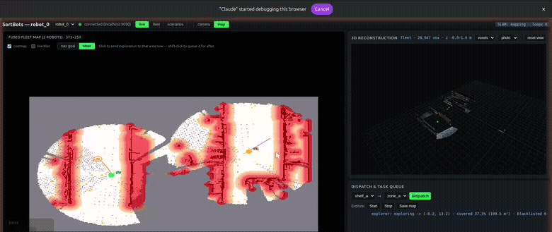
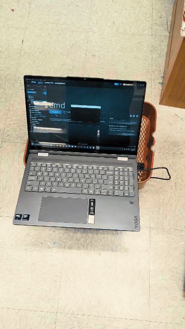
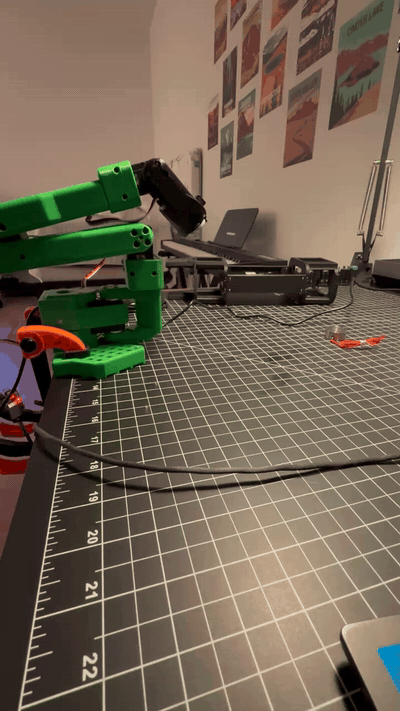
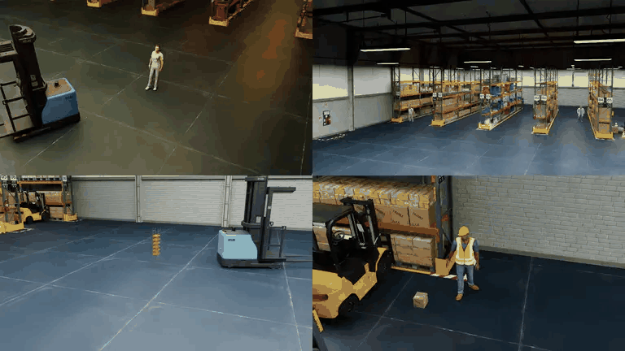
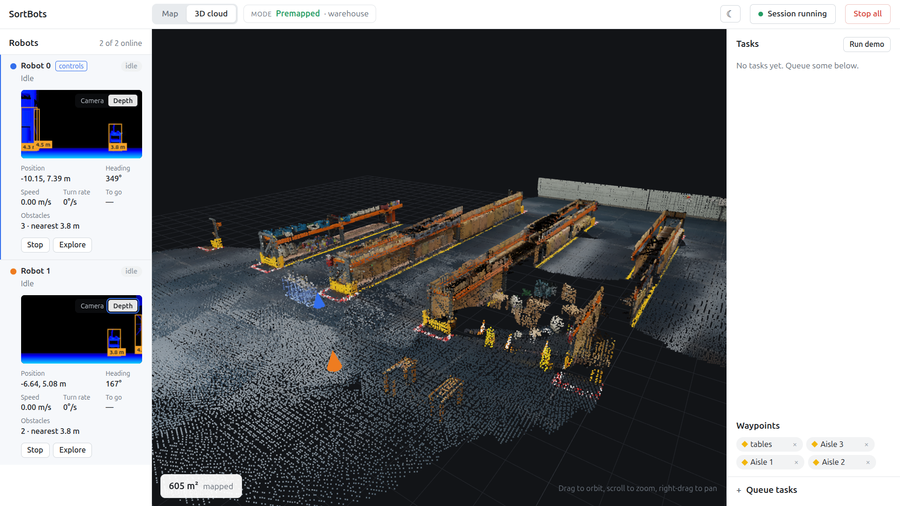
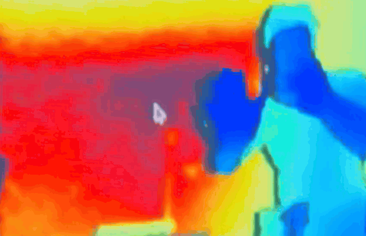

# SortBots


Fully autonomous mobile robots performing collaborative
indoor logistics, built on
[XLeRobot](https://github.com/Vector-Wangel/XLeRobot).

Unlike commercial AMR
systems that rely on extensive per-facility infrastructure,
SortBots targets the opposite operating point: rapid deployment
in unmapped environments, with collaboration as the primary
mechanism for both efficiency and resilience. Robots divide work via decentralized task allocation,
coordinate passage through shared spaces, and dynamically
re-allocate tasks when one is blocked or delayed. Applications to autonomous delivery logistics in dynamic enviornemnts, such as warehouses, shelf restocking, or serving foods in restaurants.

## Demos

### Fleet exploration mapping

Two robots exploring a fresh warehouse environment and fusing their grids into one `/map`.



Full-quality version: [`docs/media/fleet_explore_timelapse.mp4`](docs/media/fleet_explore_timelapse.mp4).

### Drive system demo

Driving the real XLeRobot base over its command-line interface.



### Arm demo

The 3D-printed arm prototype executing a manipulation sequence on the bench.



### Isaac Sim environment

The NVIDIA warehouse environment used for sim-first verification, with forklifts and a pedestrian as scripted movers.



### SLAM with feature mapping

RTAB-Map's feature view: matched keypoints and inlier counts between consecutive frames as a robot drives the warehouse, with the fused 3D point cloud building up alongside it.




### Depth to 3D points

Each depth pixel becomes a 3D point: the live RGB feed next to its colorized depth estimate.

 

### Object detection validation

Scripted test cases from the [simtest](simtest/) layer: detecting a crossing pedestrian, and one robot detecting another.


### Operator dashboard

Driving, teleport, waypoints and live camera/depth feeds for both robots from one browser tab:


### Fleet mesh comms overlay

The Comms overlay modeling Wi-Fi mesh range and link quality between robots and the gateway: both robots in direct range of the gateway, a robot out of range relaying through the other, and the overlay comparing a direct line-of-sight link against the routed path when obstacles are in the way.


### Simulation infrastructure
- **Isaac Sim** Isaac Sim 5.1 supporting SLAM pipelines and integrating with Nvidia packages such as Nvblox
- **ManiSkill (arm-manipulation sim):** XLeRobot's original sim env with extensive support for training manipulation tasks

### Perception & mapping
- **Intended sensor suite**
  - Intel RealSense D435 RGB-Depth Camera
  - MPU 6050 IMU
  - Optical Tracking Odometry Sensor - PAA5160E1
- **RGB-D SLAM:** RTAB-Map per robot; dynamic depth filter keeps movers out of the permanent grid
- **Fleet fusion (not collab SLAM):** fused 2D `/map` + fused 3D `/fleet/recon_cloud` via spawn anchors
- **Exploration:** frontier explorer on the fused map; mesh intent/status radio (no peer TF oracle)
- **Dashboard:** live view, fleet radio monitor tab, scenarios console


## Docs

- [`docs/quickstart.md`](docs/quickstart.md) — fresh device to a live fleet in one pass; **start here** (install + first run)
- [`docs/running.md`](docs/running.md) — running everything: the demo, console mode and scenarios, autonomous exploration, map lifecycle, remote access, dashboard tests
- [`docs/perception_exploration.md`](docs/perception_exploration.md) — perception, exploration, fleet mesh radio, and map/recon fusion architecture
- [`commsim/`](commsim/README.md) — fleet communication simulation: Wi-Fi mesh, Zenoh and task-allocation protocol tested to failure (results in [`commsim/docs/sim_log.md`](commsim/docs/sim_log.md))


## Run commands

Open a fresh shell at the repo root. Never activate both simulators in the same shell, and never source ROS 2 in either.


### Isaac Sim (mobile / multi-robot / ROS 2 / VSLAM track)

Two ways in. **Console mode** is the one to use day to day — you start the
dashboard once and launch runs from the browser (including from your phone):

```bash
./scripts/run_console.sh       # dashboard only; leave this terminal running
```

Then open <http://localhost:8081/> (or the tailnet URL it prints), switch the
header to **scenarios**, pick one and hit **Start**. That launches Isaac Sim +
RTAB-Map + Nav2 + the task manager for you and streams the launcher's output
into the tab; **Stop** tears the run down and leaves the dashboard up, ready
for the next one. Scenarios are presets in
[`configs/scenarios/`](configs/scenarios/):

| scenario | what it does |
|---|---|
| `explore_fleet` | **the default** — two robots exploring collaboratively from empty maps, grids fused into one `/map` |
| `explore_fresh` | single robot, fresh map, autonomous frontier exploration |
| `explore_resume` | extend the map a previous run built |
| `library_localize` | load a committed map from `maps/` and run read-only (demos, click-to-move) |
| `library_resume` | load a committed map and keep exploring it |

Adding one is a YAML file; see
[`docs/running.md`](docs/running.md#adding-a-scenario).

```bash
./scripts/run_console.sh stop  # console + any running sim
```

Scriptable equivalent, for automation or a coding agent —
`scripts/sim_ctl.sh {console start|list|dry-run|start|wait|status|log|stop}`,
with exit codes as the interface:

```bash
./scripts/sim_ctl.sh console start
./scripts/sim_ctl.sh start explore_fleet headless=true
./scripts/sim_ctl.sh wait running --timeout 420
./scripts/sim_ctl.sh stop
```

**Or drive it from the CLI**, unchanged:

```bash
./scripts/run_demo.sh             # 2-robot fleet + dashboard
./scripts/run_demo.sh --explore   # ...and explore autonomously
./scripts/run_demo.sh --robots 1  # single robot instead
./scripts/run_demo.sh stop        # shut it all down
```

`run_demo.sh` brings up the entire pipeline in one command and defaults to the
two-robot fleet. The map fills in live as the robots explore. Re-running it
resets the environment. The first run auto-builds the robot USD and streams the
NVIDIA warehouse (a few minutes; cached after).

Without a console running, the scenarios tab is read-only: it lists what exists
and says how to start the console, rather than offering buttons that can't work.

### ManiSkill (arm manipulation track)

```bash
conda activate lerobot
bash scripts/verify_sim.sh         # smoke test: SAPIEN windows for Fetch + XLeRobot
python scripts/run_xle_demo.py     # XLeRobot demo
```

More detail: [`docs/running.md`](docs/running.md).


## License

Project code: see `LICENSE` (to be added). 

XLeRobot submodule: Apache 2.0 (see `third_party/XLeRobot/LICENSE`).
