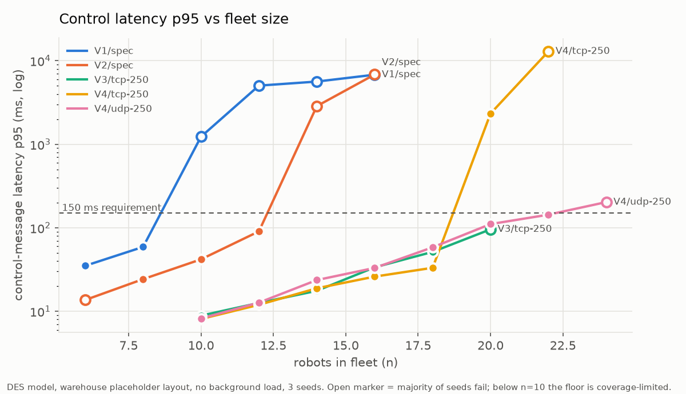

# commsim — fleet communication simulation



The SortBots fleet has no central coordinator: which robot owns which task,
who is alive and who is cut off are all decided over the radio. commsim
tests that communication design to failure **before any radios are bought**:
a self-healing Wi-Fi mesh (802.11s links, batman-adv routing), Zenoh
middleware, and a decentralized auction + lease protocol for task ownership.

The design as first written failed at every fleet size. After four fixes it
supports about 20 robots in simulation and passes 110 of 120 failure
scenarios; the same protocol code now runs on the robots.

## What it answers

- **Scale:** how many robots before the mesh or the protocol breaks, and which part breaks first
- **Failures:** whether the fleet recovers correctly from broken links, dead robots, a dead gateway, reboots, network partitions and task bursts
- **Timing:** whether the timer chain (reroute < Zenoh lease < status timeout < task lease) holds on the real software stack
- **Design choices:** which settings matter (dialling direction, Status transport, routing interval, queue depths) and which don't

Full results, with every caveat: the **Results** section at the top of
[`docs/sim_log.md`](docs/sim_log.md).

## Headline results

| Problem found | Effect | Fix (now the default) |
|---|---|---|
| Task leases renewed only by Status, which neighbour-only Status never carries outside the owner's area | robots reclaim tasks still being carried: two robots on one task from 10 robots up | **LeaseBeacon** — owners announce their tasks fleet-wide once a second |
| Both Zenoh routers of every pair dial each other | two TCP sessions per pair, one idling on keepalives: a third to a half of the airtime wasted | only the lower robot ID dials |
| Status timeout 3 s on a rerouting mesh | one broken link makes healthy robots look silent | status timeout 6 s, Zenoh lease 4 s |
| Status subscriber queue depth 1 | 15 % of Status lost on a clean link (measured) | depth 32 |

**Read before quoting a number:** no real hardware has been measured yet.
Path loss, rack attenuation, link rates and router behaviour are
placeholders until the lab testbed ([`hw/`](hw/README.md)) replaces them,
and the floor is a generic warehouse, not a real site. Link rate is the
biggest unknown: at the slow rates the emulated radios chose, the overload
point came about three robots earlier.

## How it works

Two tools, cross-checked against each other:

| | Emulation (`emu/`) | Discrete-event model (`des/`) |
|---|---|---|
| **What runs** | The **real** 802.11s, batman-adv, zenohd and ROS 2 nodes, one Linux network namespace per robot, over simulated radios (`mac80211_hwsim` + `wmediumd`) | A Python model of the radio channel (CSMA/CA), batman-style routing and Zenoh sessions, with the **real** task-allocation code (`core/protocol.py`) in every robot |
| **Good for** | Ground truth: latency, overhead per message, reroute time, bugs only the real stack shows | Scale and failure sweeps: 20+ robots, 11 failure scenarios, many seeds, seconds per run |
| **Limit** | One VM, about 20 nodes | Simplified radio: one contention domain per band |
| **Where it runs** | Inside the VM, as root ([`vm/`](vm/README.md)) | On the host, system Python |

The model is calibrated on the emulation's measurements
([`measurements/`](measurements/README.md)): median latency agrees within
3–10 %, channel load within ~6 %, and both put the overload point in the
same place.

**Separate from the Isaac Sim track.** No shared code, shell, ROS install or
launch files. The only link is `core/protocol.py`, which
`nodes/fleet_tasks.py` imports.

## Layout

| Path | What it is |
|---|---|
| `core/protocol.py` | Task allocation: auction, tie-break, leases, isolation, committed ownership. Pure Python, shared by every tool and by the robots |
| `core/fleet.py` | One fleet list → every node's IP, radio MACs, Zenoh, UDP and bridge config, plus the isolation check |
| `core/timers.py` | Refuses timer settings the measurements say will misfire |
| `core/loopback.py` | In-memory fleet for protocol unit tests |
| `des/sim.py` | The discrete-event model: radio, routing, sessions, robots, metrics |
| `des/radio.py`, `des/layout.py` | 802.11 timing and propagation; the placeholder warehouse floor |
| `des/run.py`, `des/scenarios.py` | Fleet-size sweeps; failure-scenario runs with pass/fail judging |
| `des/crosscheck.py` | Model vs emulation at the same setup |
| `des/summarize.py`, `des/scen_table.py`, `des/plots.py` | Tables and charts from results (`plots.py` needs matplotlib) |
| `emu/mesh.py`, `emu/m1.py`, `emu/reroute.py` | Build the emulated mesh; run Status stubs and capture; measure reroute time |
| `stubs/status_stub.py` | ROS 2 node run inside each emulated robot (Zenoh or UDP Status) |
| `ws/src/commsim_msgs/` | The message definitions, so wire sizes are real |
| `hw/` | **Real hardware:** OpenWrt images with the mesh packages baked in, per-router setup and host config from the same fleet list, a UDP probe, router statistics, and the bring-up and calibration runbook |
| `configs/` | `base.yaml` = the recommended design · `hw_lab.yaml` = 2 robots + gateway, 2.4 GHz only · `spec_original.yaml` = the design as first written · `ogm250.yaml`/`ogm500.yaml` = routing-interval comparisons |
| `measurements/` | Emulation measurements the model is checked against |
| `scripts/` | `fix_sweep.sh` reproduces the final comparison; `check_isolation.sh` proves traffic stays on the fleet subnet |
| `vm/` | Creating and provisioning the emulation VM |
| `viz/` | **Live model on the operator's map:** the engine behind the operator view's Comms overlay — predicted links, mesh routes and every message hop for where the real robots stand (`viz/README.md`) |
| `tests/` | Offline tests: protocol, config generation, hardware bundles, model sanity |
| `docs/` | `brief.md` (the question), `plan.md` (the approach), `sim_log.md` (results, then the full run log), `figures/` |

Every value in `configs/base.yaml` tagged `placeholder` or `estimate` is a
parameter awaiting a hardware measurement, not a fact.

## Docs

- [`docs/sim_log.md`](docs/sim_log.md) — **start here**: results at the top, then the chronological run log of what was done, why, and what came out, including the mistakes
- [`docs/brief.md`](docs/brief.md) — the original brief: what the simulation had to answer
- [`docs/plan.md`](docs/plan.md) — the plan written from the brief, and the open questions with their answers
- [`hw/README.md`](hw/README.md) — putting the design on real routers: flashing, bundles, bring-up, calibration
- [`vm/README.md`](vm/README.md) — the emulation VM
- [`measurements/README.md`](measurements/README.md) — what each reference measurement is

## Run commands

Everything below runs with the **system** Python (`/usr/bin/python3`, not
conda's) from the repo root. Nothing here needs ROS on the host.

### Offline tests (seconds)

```bash
/usr/bin/python3 -m pytest commsim/tests
```

### Discrete-event model (host)

```bash
/usr/bin/python3 -m commsim.des.run --variants V3 V4 --n 10 15 20 --seeds 1 2 3 --until-fail --out commsim/results/mine
/usr/bin/python3 -m commsim.des.summarize commsim/results/mine
/usr/bin/python3 -m commsim.des.scenarios --variants V4 --n 10 --seeds 1 --out commsim/results/scen
/usr/bin/python3 -m commsim.des.crosscheck          # model vs emulation, 3-node line
/usr/bin/python3 -m commsim.des.crosscheck n10      # model vs emulation, 10-node warehouse
commsim/scripts/fix_sweep.sh                       # the full before/after comparison (~1 h)
```

Add `--configs commsim/configs/spec_original.yaml` to any run to see the
design as first written. Cap memory on sweeps (`systemd-run --user --scope
-p MemoryMax=3G …`); they are parallel by default.

### Emulation (inside the VM, as root)

```bash
sudo python3 -m commsim.emu.mesh up --n 3 --line
sudo python3 -m commsim.emu.m1 --n 10 --layout warehouse --out /run/commsim/m1
sudo python3 -m commsim.emu.reroute --trials 6
sudo python3 -m commsim.emu.mesh down
```

`multipass exec` joins its arguments into one remote shell string, so put
multi-step VM commands in a script under the gitignored `commsim/results/`
(mounted in the VM) and run that. Every `m1` run also records per-receiver
captures, a route poller and a link log; `--unblock-at`
reopens the link `--block-at` pulled; `--alloc --task-every 8` makes the
stubs run the real task allocator over UDP so auctions happen on the real
stack.

### Live model on the map (host, no VM)

The DES runs live behind the operator view's **Comms** overlay: open the
dashboard (`webui/serve.py` / `scripts/run_console.sh`), then turn on Comms
next to Map / 3D cloud. The real robots' poses and the explored map's obstacles
go in; predicted links, routes and message hops come out. See
[`viz/README.md`](viz/README.md).

### Real routers (laptop)

Bundles hold the mesh key; keep them in the gitignored `results/`:

```bash
/usr/bin/python3 -m commsim.hw.firmware --out ~/sortbots-firmware
/usr/bin/python3 -m commsim.hw.deploy commsim/configs/base.yaml commsim/configs/hw_lab.yaml \
    --mesh-key-file ~/.config/sortbots/mesh.key --out commsim/results/hw
```

The whole procedure, flashing to calibration: [`hw/README.md`](hw/README.md).

### Fleet configs and the isolation check

```bash
/usr/bin/python3 -m commsim.core.fleet gen commsim/configs/base.yaml --out /tmp/fleet
commsim/scripts/check_isolation.sh --subnet 10.42.0.0/24 --configs /tmp/fleet
```

## On the robots

`core/protocol.py` is not only simulated. `nodes/fleet_tasks.py` runs the
same `Allocator` on each robot over ROS 2 topics and feeds the tasks it wins
to `nodes/task_manager.py`; one more instance with `--gateway` (the laptop,
or the sim bringup) takes `/fleet/task_request` and announces. The bringup
launch starts the robot side with `task_manager:=true`. Tuning is
`configs/fleet_tasks.yaml`, with the same keys as `configs/base.yaml`
`protocol:`.

- **Bids** are seconds of driving along the fused `/map` (`nodes/grid_dist.py`), straight line until a map arrives, plus a battery penalty; the backlog of tasks a robot already holds is included
- **Up to 3 tasks per robot**, worked in claim order; each must pass the radius and battery criteria on its own
- **Committed ownership:** once the item is picked up the task never yields, keeps going while cut off, is not reclaimed elsewhere, and a failed dropoff is retried by the same robot. Only completion or a gateway cancel ends it
- **Restart:** `fleet_tasks` reads task_manager's latched status; a carried task is adopted, anything else is cancelled and re-auctioned
- **Between hosts**, `scripts/fleet_bridge.sh` carries `/fleet/*` and nothing else over the mesh ([`hw/README.md`](hw/README.md), step 7)

- **The operator's board (2026-10-20):** the gateway publishes `/fleet/task_board` (latched, 1 Hz): every robot it has heard with `alive` (its own `status_timeout_s` verdict, so the GUI and the fleet agree), `last_heard_s`, `battery_pct`, `owned` and `carrying` task ids; every task with owner and `committed`; and latched alarms (`robot_silent`, `owner_missing`, `lease_expired`, `task_stalled`) that stay until acknowledged on `/fleet/alarm_ack`. The operator view renders it: battery and *silent* on the robot cards, owners in the task list, alarms in the header chip. In the model the same guarantee is a judged check: the gateway must hear every reachable robot within `status_timeout_s` (`gateway_view` failure, `des/sim.py`), which the 1 Hz gateway copy of Status satisfies at every tested size

Offline tests: `tests/fleet_tasks_test.py`, `tests/fleet_bridge_test.py`,
`tests/grid_dist_test.py`. Request a task with `/fleet/task_request`, watch
`/fleet/task_board`.

## Decisions and open items

- **Partitions:** an owner that still hears its own half of a split network keeps working, so both halves may work the same task until the split heals; the tie-break then picks one owner in about 2 s. Accepted by design for now (`tests/protocol_test.py::test_partition_heal_converges_by_tie_break`); `docs/plan.md` question 11 lists the alternatives.
- **Tasks per robot (2026-10-19):** one robot per task, up to 3 tasks per robot (`max_owned_tasks`), bids include the backlog.
- **Committed ownership (2026-10-19):** before this, a robot carrying an item could lose the task and the next owner was sent to an empty shelf. DES partition at n = 10: duplicate episodes 4–5 → 1–2 per run (V2), 1–3 → 0–2 (V4). Two committed owners of one task (only possible in simulation) resolve by robot ID, and the loser is told it holds the item.
- **Status recipients over UDP** are currently every robot (right for small fleets). Neighbour-only Status needs a small "which areas I listen to" announcement before scaling past ~10 robots.

## Status

| Verified | Not yet |
|---|---|
| Protocol, config generation, bundles, bridge topic list: offline tests, CI | Any radio: no router has been flashed, no mesh has formed, every propagation number is a placeholder |
| Model vs emulation calibration at 3 and 10 nodes | Bridge inside the Jetson container (checked laptop-to-laptop only) |
| Auction over the real JSON wire format with a fake task_manager | A two-robot Isaac run with both robots bidding (needs ~10 GB; the laptop fits one robot). Until 2026-10-19 secondaries ran `--no-bid` |
| | `grid_dist.py` against a live map; the mock arm (`scripted_pick.py --mock`) under a launch |
