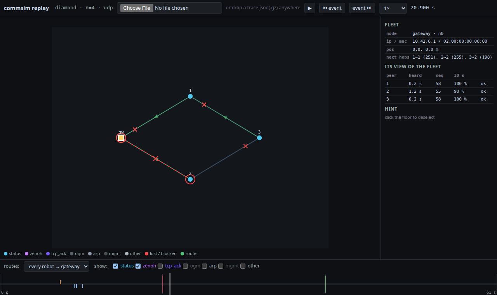

# commsim/viz — packet-transfer replay

Watch the emulated fleet talk: every frame the radios sent, hop by hop, over
the warehouse floor — which relay a Status crossed, where it was dropped, how
batman re-routed after a link was pulled, and what each robot believed about
who was alive. A replay of one recorded run, not a live view.



| What you see | Where it comes from |
|---|---|
| Robots and the gateway on the floor, links shaded by SNR | `mesh_state.json` (positions, SNR matrix) + `des/layout.py` geometry |
| A dot per frame travelling its hop, coloured by kind; broadcasts as rings | `hwsim0.pcap` — every over-the-air frame |
| Red X where a hop was lost; red ring at a sender whose packet never left | receiver captures `rx_<i>.pcap` (ground truth), hwsim0 ACKs as fallback; stub send logs |
| Green arrows: batman next hops (every robot → gateway, or from a selected node) | `poll_<i>.txt` — `batctl meshif bat0 o` sampled every 0.5 s |
| Dashed red link with an X: a blocked peer link | `links.jsonl` — every `plink_action` the run injected |
| "N silent" under a node; per-peer table when selected | derived from the stubs' receive logs with the fleet's `status_timeout_s` |
| Timeline ticks: red/green link block/unblock, amber/blue silent/back, grey marks | the same events |

## Run it

Everything on the host uses the system Python (`/usr/bin/python3`). The
emulation itself runs in the VM ([`../vm/README.md`](../vm/README.md)).

```bash
# 1. record a run in the VM — m1.py now captures everything the replay needs
#    (full-snaplen hwsim0, per-receiver captures, route poller, link log)
cat > commsim/results/myrun.sh <<'EOF'
cd /home/ubuntu/SortBots
python3 -m commsim.emu.m1 --n 4 --links 0-1,0-2,1-3,2-3 --duration 60 --transport udp \
    --orig-ms 250 --block-at 20 --unblock-at 40 --out /run/commsim/diamond
mkdir -p commsim/results/diamond && cp -r /run/commsim/diamond/. commsim/results/diamond/ && rm -rf /run/commsim/diamond
EOF
multipass exec commsim -- sudo bash /home/ubuntu/SortBots/commsim/results/myrun.sh

# 2. build the trace (prints a sanity report: frames by kind, delivery, ACK match)
/usr/bin/python3 -m commsim.viz.build_trace commsim/results/diamond --pos "0:0,0 1:5,3 2:5,-3 3:10,0"

# 3. open the page
python3 -m http.server 8000 --bind 127.0.0.1   # at the repo root
# http://127.0.0.1:8000/commsim/viz/index.html?trace=/commsim/results/diamond/trace.json
```

Or open `index.html` straight from disk and drop `trace.json` (or
`trace.json.gz`) onto it — `file://` pages cannot fetch, which is why both
paths exist.

`build_trace` options: `--window T0 T1` (seconds into the capture),
`--kinds status,icmp` (air kinds to keep), `--gz`, `--max-inflight-ms`
(ACK-pairing fallback cutoff), `--pos "i:x,y …"` (positions for `--links`
runs, which have no floor).

Page: space plays/pauses, ←/→ step 1 s (shift: 10 s), ⏮/⏭ jump between
link and silence events, click a node for its view of the fleet, the
checkboxes hide kinds (OGMs, management, ACK-only TCP are hidden by default
— they are most of the frames and none of the story).

## The trace format (`commsim-viz/1`)

One JSON document — the page needs the header before it can draw, it scrubs
rather than streams, and one URL / one dropped file keeps both load paths
identical. ~12–15 MB for n = 10 over 120 s (gzip: ~2 MB).

```
{"format": "commsim-viz/1",
 "header": {name, n, transport, hz, orig_ms, duration_s, t0_ns, built_at, source_dir,
            layout {name, width, height, racks, shelves, aisles_y, cross_x, gateway_pos[, origin]},
            nodes [{id, ns, ip, mac, bat0_mac, pos, gateway}], snr [[dB]],
            knobs {status_timeout_s, status_hz, orig_interval_ms, zenoh_lease_ms, batadv_ttl, ...},
            counts {air_by_kind, app_tx, app_rx, unacked, outcomes, delivery}, limits [...]},
 "events": [ ... sorted by t ... ]}
```

`t` is integer microseconds since `header.t0_ns` (the first hwsim0 record;
pcap timestamps and the stubs' `time.time_ns()` share CLOCK_REALTIME in the
VM, so nothing needs aligning). Event kinds:

| `k` | fields | meaning |
|---|---|---|
| `air` | `ta ra kind size rate mseq [mttl ttl hop dest src dst seq] ack dur via [ok]` | one frame on the radio. `ra: -1` = broadcast. `ack` true/false/null(broadcast); `dur` µs = receiver time − TX (`via: "rx"`) or ACK − TX (`via: "ack"`), modelled when lost; `ok` on the last hop of a Status: `ok` / `lost` / `lost_after` |
| `app_tx` | `src seq` | the stub sent a Status |
| `app_rx` | `src dst seq lat_us` | a stub received one |
| `drop` | `src dst seq why` | a Status the stub sent that never went on air toward `dst` (`unroutable`) |
| `route` | `node dst nh tq` | a next-hop change seen by the poller (`nh: -1` = route gone); the first sample is emitted in full |
| `linkstat` | `a b plink signal tx retries failed` | per-peer station-dump deltas |
| `link` | `a b action` | `block` / `unblock` injected by the run |
| `robot_silent` / `robot_back` | `obs peer [gap_us]` | derived: `obs` heard nothing from `peer` for `status_timeout_s` / heard it again |
| `mark` | `text` | run phases (`captures_started`, `stubs_started`, …) |

## What it cannot show (yet)

- **Only Status traffic.** The emulation runs Status stubs, not the task
  allocator, so there are no TaskAnnounce/Bid/Claim/LeaseBeacon frames and
  no owned-task state. `robot_silent` is derived from receive gaps with the
  same rule `core/protocol.py` applies; when a stub runs the Allocator,
  `build_trace --protocol-log` is the hook to read its events instead.
- **Retries are invisible.** wmediumd retries inside itself; hwsim0 shows one
  TX per frame. `dur` of a delivered hop includes that queueing.
- **Hop delivery is exact only with receiver captures** (`rx_<i>.pcap`, every
  run since 2026-10-20). Older runs fall back to pairing hwsim0's ACK records,
  which name only the transmitter: one lost copy of a Status mis-pairs the
  ACKs that follow until the queue drains (`via: "ack"`, best effort).
- **`rate`** is the rate the kernel requested at handoff, not what wmediumd
  used; `0` = unknown (ACK records carry none).
- **Zenoh runs:** TCP payloads are opaque, so hops carry IPs only and
  delivery/silence come from the stub logs alone.
- Positions are static: the emulation does not move nodes.
- **The first ~8 s are a start-up transient**, not a finding about the
  design: no unicast flows on the mesh until ARP resolves, so every Status
  the stubs send in that window shows as `unroutable` (red rings at the
  senders). `m1.py`'s 20 s warmup hides it from the measurements; a trace
  judged over its whole length reports delivery accordingly (A/B-checked:
  identical with the replay captures off). Open question for the hardware
  runbook — a robot joining the mesh may be mute for that long.

## Tests

```bash
/usr/bin/python3 -m pytest commsim/tests/viz_test.py        # decoders (incl. a real captured frame), trace builder, fixture
node --experimental-websocket commsim/viz/tests/viz_test.mjs # the page, headless Chrome (see the file header)
/usr/bin/python3 -m commsim.viz.testdata.make_fixture        # regenerate testdata/trace_small.json after format changes
```

## Layout

| File | |
|---|---|
| `pcap.py` | pure-Python decoders: pcap, radiotap, 802.11(+mesh control), LLC/SNAP, batman-adv IV, Ethernet/IPv4/UDP/TCP/ICMP, the Status CDR header |
| `build_trace.py` | run directory → trace: hop join, ACK fallback, outcomes, silence, route/linkstat deltas |
| `index.html`, `viz.js` | the page; `window.__viz` is the test hook |
| `testdata/make_fixture.py` | byte builders mirroring the decoders + a synthetic 3-node run; writes `trace_small.json` |
| `tests/viz_test.mjs` | headless page test |
