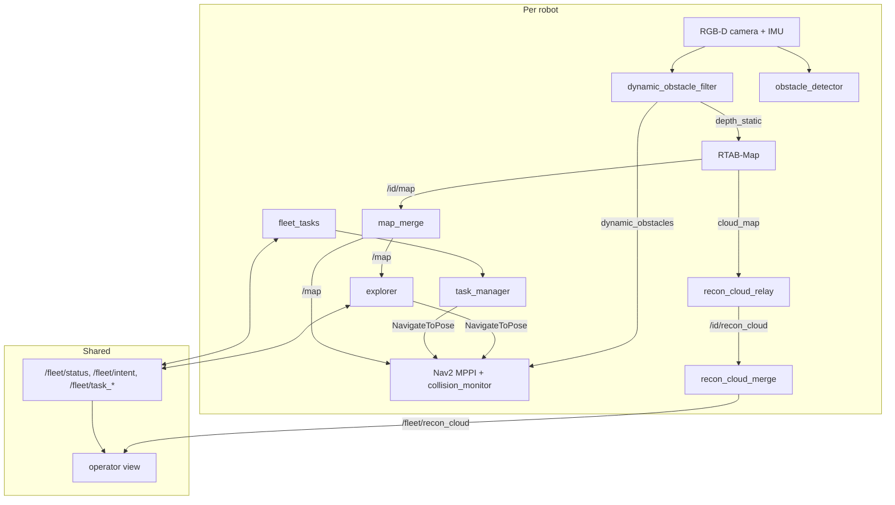

# Architecture

## Repo layout and invariants

There are three tracks. They share no shell.

| Track | What | Environment |
|---|---|---|
| **Isaac Sim + ROS 2 Jazzy** (main) | mobility, SLAM, Nav2, fleet | `~/isaacsim/venv` plus system ROS 2, each in its own subshell |
| **Real robot** | the same stack on a Jetson Orin Nano with a RealSense D435 | Jazzy Docker container (`docker/jetson/`) |
| **ManiSkill** | arm manipulation | conda env `lerobot` |

This is **not a colcon workspace**. There is no `src/` and no `package.xml`. Nodes
are loose scripts started by path. Inter-node messages are `std_msgs/String`
carrying JSON. Node tuning is plain YAML that each node loads itself.

| Path | Contents |
|---|---|
| `nodes/` | rclpy nodes (`explorer.py`, `task_manager.py`, `map_merge.py`, …), run as `python3 <path> --robot-id …` |
| `launch/` | `ros2 launch ./launch/<file>`, by path. `sortbots_bringup.launch.py` is the entry point |
| `scripts/` | entry points: `run_console.sh`, `sim_ctl.sh`, `run_demo.sh`, `run_robot.sh`, `jetson.sh`, `maps.sh`, `simtest.py`, `splat.sh`, installers |
| `webui/` | the operator view (vanilla JS, no build step), `serve.py` (HTTP + control API), `session.py` (scenario runner) |
| `configs/` | tuning YAML, `scenarios/`, `worlds/`, `tests/`, `robots.yaml` (roster and spawn poses) |
| `simtest/` | scored live tests: worlds, probe, versioned metrics |
| `maps/` | committed library of saved maps (git-lfs) |
| `splat/` | Gaussian-splat reconstruction (workstation only) |
| `commsim/` | fleet radio and task-protocol simulation |
| `hardware/` | CAD for the SO-101 electromagnet end effector |
| `third_party/XLeRobot` | submodule (Apache 2.0) |

**Invariants that cost the most time when broken:**

- **Never `source /opt/ros/...` in a shell that launches the sim**, and never in
  `~/.bashrc`. It shadows the Isaac venv and conda. The scripts source ROS in their
  own subshells and refuse to run if `AMENT_PREFIX_PATH` is set.
- **conda's `python3` leads PATH.** Anything with an `#!/usr/bin/env python3` shebang
  that needs rclpy (rosbridge, `ros2`) fails with `No module named
  'rclpy._rclpy_pybind11'`. In ROS shells, `which python3` must print `/usr/bin/python3`.
- **Every web_video_server `/snapshot` request needs `qos_profile=sensor_data`**,
  ad-hoc `curl` included. Churning RELIABLE image subscriptions kill Isaac's image
  writers at around sim t=100–140 s.
- **A saved map is loaded by copy, never in place** (see [Maps](running.md#maps)).
- **Measure speed in sim time.** The real-time factor depends on how many cameras
  render: about 0.47× with 2 robots, 0.33× with a chase cam added, 0.25× with the
  full ROS stack. `scripts/bench_sim.sh` measures it.

## How the stack fits together



**Fusion, not collaborative SLAM.** Each robot runs its own RTAB-Map in its own
`<id>/map` frame. The bringup publishes a static `map → <id>/map` transform from each
robot's spawn pose (`configs/robots.yaml`). `map_merge.py` and `recon_cloud_merge.py`
resample every robot's grid and cloud into the world `map` frame. Where grids
disagree, occupied beats free beats unknown. There is no shared pose graph and no
inter-robot loop closure. Robots never read each other's poses off `/tf`. Peers are
known only from self-reported `/fleet/status`, the same radio channel a real fleet
would have.

### Perception

| Node | Job |
|---|---|
| `dynamic_obstacle_filter.py` | Masks moving pixels, plus pixels within 0.5 m of a peer's reported pose, out of depth → `depth_static` (keeps movers out of SLAM) and `dynamic_obstacles` (to Nav2). Sim only. |
| `obstacle_detector.py` | Geometric clusters above the floor, tracked in odom by a constant-velocity Kalman filter with a `moving` flag and a 0.5–1.5 s look-ahead → `/<id>/obstacle_tracks` (JSON: `pos_w`, `vel`, `cov`, `pred`), `obstacle_points`, `obstacles_viz`, and `predicted_obstacles` (moving tracks' footprints swept 1.5 s ahead, a local-costmap source). No classifier: geometry catches anything with physical extent, at about 13 ms/frame. Runs on both platforms. Tuning: `configs/obstacle_detector.yaml`. |
| `obstacle_cloud.py` | The real robot's raw live obstacle cloud when SLAM is offloaded. |
| RTAB-Map | One per robot (`launch/sortbots_rtabmap_robot.launch.py`). Started with `MALLOC_ARENA_MAX=2`, which cut its memory growth by about half. |
| `recon_cloud_relay.py` | Caps `cloud_map` at 200k points so rosbridge and the browser can keep up. |

**Obstacle tracking and prediction.** A detection joins the Kalman track whose
predicted position it is closest to by Mahalanobis distance (`kf_gate_chi2`, inside
`track_gate_m`). A cluster whose centroid can't be trusted (`can_move`: clipped by the
image edge or the range crop, long and flat, or longer than `max_moving_extent_m` unless
it is also tall — the large-mover rule that admits a forklift) updates the track's
position but has its velocity zeroed. `moving` needs `track_min_hits` frames at
`moving_speed_mps`. `pred` is the state extrapolated `pred_horizons_s` ahead: a 1–2 s
claim, not a route. `/<id>/predicted_obstacles` sweeps each moving track's footprint
`pred_cloud_horizon_s` along its velocity, in base_link, every frame and EMPTY when
nothing moves, so the LOCAL costmap's `predicted_scan` source (persistence 0, `clearing:
false`) routes the controller behind a walker instead of through where they are about
to be. The marks are lethal like any costmap obstacle, so the horizon stays short; the
collision monitor on `depth_static` stays the safety floor. Scored by the simtest
`prediction` metric (`docs/testing.md`). First live run (2026-11-06): the person is
tracked at 5 m and called moving at 4 m, 5 s before the robot brakes onto their line —
the avoidance gap is in Nav2's response, not in perception.

Sim topics live under `/<id>/`: `camera/{rgb,depth,camera_info}`, `imu`, `odom`,
`cmd_vel`. TF frames are prefixed (`robot_0/base_link`) on the shared `/tf`.

### Navigation and exploration

- **Nav2** (`configs/nav2_params.yaml`, rewritten per robot by
  `sortbots_nav2.launch.py`): MPPI with a `DiffDrive` motion model so the forward
  camera faces the direction of travel, a reactive BT, and `collision_monitor` as
  the last-resort stop. The base is holonomic, but Nav2 never commands strafing.
- **Two namespacing traps:** the costmap's `map_topic` must be absolute, and
  `behavior_server` needs `local_frame: robot_0/odom` set explicitly. With that
  unset, every recovery aborts instantly and a wedged robot can never free itself.
  In params YAML under a namespace, key nodes as `/**/<node>:`.
- **Explorer** (`nodes/explorer.py`, `configs/explorer.yaml`): frontier exploration
  on the fused `/map`. It scores frontiers by size, distance and openness, and
  blacklists unreachable ones with escalating strikes. It retargets as soon as the
  frontier it was heading to gets revealed en route. It also has an escape /
  backtrack / stuck watchdog and a startup spin. Fleet deconfliction uses
  `/fleet/intent` (goal and corridor; lower priority yields) and `/fleet/status`.
- **Steering:** `<id>/explore_hint` `{"x","y"[,"append"]}` locks the explorer onto
  the frontier nearest the click until that area is mapped, `steer_ttl_s` expires,
  or the frontier proves unreachable.
- **Timers:** `create_timer` follows `use_sim_time`, which stretches a control tick
  by the real-time factor. Put deadlines on sim time and responsiveness ticks on an
  explicit steady clock, as `explorer.py` does.

### Tasks and the fleet auction

`task_manager.py` keeps one FIFO queue per robot and drives Nav2 through pickup →
dropoff. `fleet_tasks.py` runs on every robot, plus one `--gateway` instance in the
sim bringup. There is no central dispatcher. Every robot runs the same allocator
(`commsim/core/protocol.py`) on the same messages, so they all agree on the winner:

- The gateway announces each task from `/fleet/task_request`.
- Robots bid seconds of driving on the fused map (`grid_dist.py`), plus their
  backlog and a battery penalty. A robot under 20% battery stops bidding.
- The cheapest robot claims the task after a 1 s window. A robot holds up to 3 tasks.
- Leases (1 Hz beacon, 10 s expiry) move a task off a robot that went silent.
- Once a load is on board, the task never moves. The others raise `owner_missing`
  instead.
- A majority quorum stops a network split from putting two robots on one task.

The gateway publishes `/fleet/task_board` (latched, 1 Hz) and latches alarms
(`robot_silent`, `owner_missing`, `lease_expired`, `task_stalled`) until they are
acknowledged on `/fleet/alarm_ack`. Tuning is in `configs/fleet_tasks.yaml`.

```bash
ros2 topic pub --once /fleet/task_request std_msgs/String '{data: "{\"pickup\": \"A\", \"dropoff\": \"B\"}"}'
```
