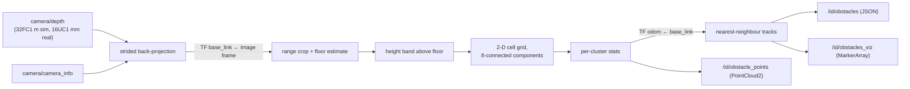

# Obstacle detection

What is physically in front of the robot, and whether it is moving.
[`nodes/obstacle_detector.py`](../nodes/obstacle_detector.py), tuned by
[`configs/obstacle_detector.yaml`](../configs/obstacle_detector.yaml), started
for every robot on every platform by `launch/sortbots_bringup.launch.py`.
Tracking issue: #3.

## Why geometry, not a classifier

Nav2 needs to know where something is occupied and whether it moves. It
doesn't need to know what the thing is. So this is a motion-segmentation
problem, not object recognition:

- **Safety.** Geometry sees anything with physical extent. A learned detector
  silently misses classes it wasn't trained on, and that is how a robot drives
  into something.
- **Cost.** No labelling or training, deterministic, numpy-only, about 13 ms a
  frame at 848x480 on the workstation (worst case, random depth).
- **Validation.** Sim ground truth gives precision, recall and centroid error
  directly.

A learned segmenter can be added later, and only if a class-specific policy
needs one (for example a wider berth for people). It stays out of the safety
path.

## How it differs from `dynamic_obstacle_filter.py`

| | `dynamic_obstacle_filter.py` | `obstacle_detector.py` |
|---|---|---|
| Question | which depth pixels changed since last frame | what is in front of me, is it moving |
| Job | keep movers out of SLAM (`depth_static`) | obstacle list for Nav2, tests, dashboard |
| A person who stops | disappears | stays an obstacle, `moving` goes false |
| The robot turning | every pixel "changes" | motion is measured in odom, so it's taken out |
| Real robot | off (CPU) | on |

They run side by side, and neither feeds the other.

## Pipeline



1. **Back-projection.** Every `stride`-th pixel goes through the pinhole model
   from `camera_info`. The input is `camera/depth`, not a point-cloud topic,
   because no `/camera/points` is published on either platform. Each point keeps
   its full-resolution (u, v) so image boxes don't depend on the stride.
2. **To base_link.** The transform comes from TF at the image's own frame and
   stamp, falling back to the latest. The camera frame is read from the image
   header: it is `head_camera_rgb_optical_frame` in sim and the driver's optical
   frame under `<id>/camera_link` on hardware, so neither is hardcoded.
3. **Floor.** The floor is the densest z-bin within ±`floor_search_m` of
   `floor_z_m`. Legs and box sides spread across many bins and never out-vote a
   plane. The node smooths the estimate across frames and keeps the last value
   when little floor is in view. This removes the need for an exact base_link
   height: the sim's comes from the USD, and the real mount
   (`configs/sensors/d435_real.yaml`) is still unmeasured.
4. **Height band.** Keeps points from `min_height_m` to `max_height_m` above the
   floor.
5. **Clustering.** Points are binned into `cell_m` columns in x/y, and touching
   columns (8-connected) form one cluster. The link distance is therefore
   between 1 and ~2.8 × `cell_m`. This is a numpy stand-in for DBSCAN, because
   scipy and sklearn aren't repo dependencies. Columns with fewer than
   `min_cell_points` count as speckle.
6. **Stats.** Each cluster gets its centroid, axis-aligned bbox in base_link,
   height above the floor, range to its *nearest* point, bearing, and image box
   `uv = [u0, v0, u1, v1]`. Clusters are listed nearest first.
7. **Tracking.** Greedy nearest-neighbour association on centroids in
   `<id>/odom`, gated by `track_gate_m` around each track's predicted position.
   Velocity is an EMA of frame-to-frame displacement. A track counts as
   **`moving`** after `track_min_hits` frames at ≥ `moving_speed_mps`, but only
   if the cluster is at most `max_moving_extent_m` long. Long structure such as
   a shelf slides its centroid along as more of it comes into view, and that
   would otherwise read as motion. Times are message stamps, so sim time works.
   If odom TF is missing, tracking falls back to base_link and logs a warning
   once: `moving` is then only meaningful while the robot stands still.

## Outputs

All outputs carry the source depth image's stamp.

| Topic | Type | Frame | For |
|---|---|---|---|
| `/<id>/obstacles` | `std_msgs/String` JSON | base_link (+ odom for tracks) | tests, dashboard |
| `/<id>/obstacle_points` | `sensor_msgs/PointCloud2` (BEST_EFFORT) | `<id>/base_link` | a future Nav2 `ObstacleLayer` source |
| `/<id>/obstacles_viz` | `visualization_msgs/MarkerArray` | `<id>/base_link` | RViz: a box per cluster (red = moving, amber = static) + label |

`/<id>/obstacles` payload:

```json
{
  "stamp": 123.4, "frame": "robot_0/base_link", "world_frame": "robot_0/odom",
  "floor_z": 0.01, "w": 848, "h": 480, "count": 2, "moving": 1,
  "obstacles": [{
    "track_id": 7, "moving": true, "speed_mps": 1.1, "vel": [0.0, -1.1], "hits": 9,
    "centroid": [2.2, 0.4, 0.8], "min": [2.1, 0.2, 0.1], "max": [2.3, 0.6, 1.7],
    "extent_m": 0.4, "height_m": 1.7, "range_m": 2.1, "bearing_deg": 10.3,
    "n": 900, "uv": [200, 100, 320, 460]
  }]
}
```

`vel` is in `world_frame`, and positions are in `frame`. `world_frame` is
`null` when tracking fell back to base_link.

## Seeing it

- **Dashboard.** Open `index.html` → camera → **head + depth**. Boxes are drawn
  over the head RGB: red for moving, amber for static, each labelled with track
  id, nearest range and speed. A tag at top-left counts obstacles and turns red
  while something moves, and the **obstacles** toggle hides the boxes. In sim
  the depth and RGB images come from one camera, and on the D435 depth is
  aligned to colour, so a depth pixel is an RGB pixel. The JSON is only
  subscribed while that view is up.
- **RViz.** Add a MarkerArray display on `/<id>/obstacles_viz`, with
  `<id>/base_link` or `map` as the fixed frame.
- **CLI.** Prints each frame's JSON:

```bash
bash -c 'export PATH=/usr/local/sbin:/usr/local/bin:/usr/sbin:/usr/bin:/sbin:/bin
         source /opt/ros/jazzy/setup.bash
         ros2 topic echo --field data /robot_0/obstacles'
```

## Writing tests against it

A "person crosses the field of view" case can assert on `/<id>/obstacles` alone:

- **Detected.** Some frame has an obstacle whose `uv` box or bearing matches the
  person, with `height_m` around body height.
- **Recognised as moving.** That obstacle's `track_id` stays stable across the
  crossing, `moving` goes true, and `vel` points along the walk direction.
- **Gone after.** Once the person leaves the frame, the track drops within
  `track_max_age_s`.

`tests/obstacle_detector_test.py` covers the same cases offline with
ray-cast synthetic depth (`test_end_to_end_person_crossing_rendered_frames`),
and `webui/tests/obstacle_overlay_test.mjs` covers the dashboard drawing.

## Known limits and next steps

- **Partial views.** A cluster cut off at the image edge or `max_range_m` has a
  biased centroid. A person entering the frame reads as moving slightly faster
  than they are.
- **People near shelving.** A person within ~2 cells of shelving merges into
  the shelf's cluster. That cluster is then too long to be called moving, so it
  still counts as an obstacle but not a moving one.
- **Not yet in Nav2.** Pointing an `ObstacleLayer` at `obstacle_points` needs
  the Nav2 team's call on format (PointCloud2 vs `vision_msgs/Detection3DArray`
  vs JSON). See the open question on #3.
- **v2.** Kalman tracks with short-horizon (~1–2 s) prediction for directional
  costmap inflation. Prediction only biases the plan, and current occupancy
  stays the hard safety floor.
- **Fleet.** Beyond-line-of-sight and shared obstacles depend on the comms
  subsystem.
